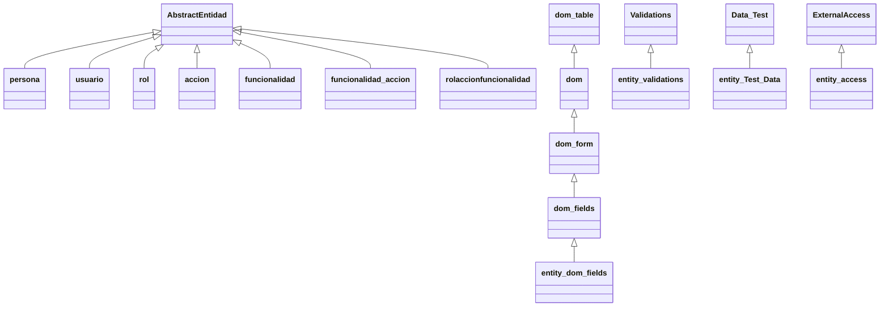

# Guía de arquitectura y defensa — ET2 IU262715

Revisión: **06/11/2026** · proyecto: `ET2_IU262715`

Esta guía describe el código actual de la ET2 completa. El proyecto de aprendizaje de la ET1 es independiente. No hay que estudiar recorridos antiguos como si siguieran activos. El cuestionario y su solucionario utilizan esta misma versión.

Última comprobación del código entregable, 06/11/2026: 477 pruebas de campo y 1357 comprobaciones auxiliares correctas con BACK simulado; se corrigieron el idioma dinámico de matriz y el tratamiento de respuestas SEARCH incompletas. El código de `app` tiene 315 métodos/constructores documentados con JSDoc; no es necesario memorizar sus cuerpos. Primero entiende responsabilidades y recorridos y después utiliza el inventario para localizar cada método.

## Índice

1. [Explicación para empezar la defensa](#1-explicación-para-empezar-la-defensa)
2. [Archivos, clases y responsabilidades](#2-archivos-clases-y-responsabilidades)
3. [Configuración, estado y contexto](#3-configuración-estado-y-contexto)
4. [Recorridos completos de la interfaz](#4-recorridos-completos-de-la-interfaz)
5. [Validaciones y decisiones por entidad](#5-validaciones-y-decisiones-por-entidad)
6. [Matrices y búsqueda de asociaciones](#6-matrices-y-búsqueda-de-asociaciones)
7. [DOM, eventos, estilos e idiomas](#7-dom-eventos-estilos-e-idiomas)
8. [Acceso al BACK y paginación](#8-acceso-al-back-y-paginación)
9. [Definiciones, pruebas y ejecución de TEST](#9-definiciones-pruebas-y-ejecución-de-test)
10. [Archivos del profesor y adaptación local](#10-archivos-del-profesor-y-adaptación-local)
11. [Preparar la demostración y la entrega](#11-preparar-la-demostración-y-la-entrega)
12. [Inventario de métodos de app](#12-inventario-de-métodos-de-app)

## 1. Explicación para empezar la defensa

«La aplicación permite a un administrador gestionar personas, usuarios, roles, acciones, funcionalidades y sus asociaciones. Las cinco entidades normales se presentan en tablas y se gestionan mediante formularios. Las relaciones se gestionan con matrices: marcar asigna y desmarcar desasigna. Buscar en una matriz abre un modal de filtros y no modifica permisos.

Cada clase de entidad declara sus campos, reglas y políticas de acción. La clase DOM construye y actualiza los componentes. `entity_ui` coordina la preparación, la validación y las operaciones. `entity_access` hace las peticiones y adapta las respuestas. Los colaboradores se configuran sin editar Core ni Base.

Se valida al introducir los datos y antes del envío. El servidor puede rechazar una operación aunque los campos sean correctos; en ese caso mostramos el código del BACK y conservamos el formulario. El botón TEST ejecuta los casos de validación en una ventana nueva.»

La pregunta para entender cualquier método es: **¿recibe datos, decide reglas, cambia la interfaz o solicita una operación?** Un método puede coordinar varias tareas, pero delega cada responsabilidad en su colaborador.

### Orden de estudio

1. Sigue un ADD de persona completo, desde el icono hasta el refresco
2. Compara EDIT, DELETE y SEARCH con ese recorrido
3. Explica el formulario y el contexto sin confundirlos
4. Sigue una casilla de la matriz
5. Ejecuta TEST y lee una fila de resultado
6. Consulta el inventario cuando no recuerdes un nombre

## 2. Archivos, clases y responsabilidades

### 2.1 Qué contiene cada directorio

| Lugar | Contenido y responsabilidad |
|---|---|
| `index.html` | Estructura de la página y cargas de scripts del profesor; los textos y componentes cambian después mediante JavaScript |
| `Base/AbstractEntidad_Class.js` | Clase base de la que heredan las siete entidades |
| `Base/css/IU.css` | CSS original de los componentes de interfaz y modales |
| `Core/` | Infraestructura original de DOM, validaciones, acceso y ejecución de pruebas |
| `locale/idioma.js` | Funciones originales de idioma y cookies |
| `iconos/` | Imágenes de acciones, fichero e idiomas |
| `app/persona/` y otros seis directorios | Una clase de gestión y un fichero de definiciones/pruebas por entidad |
| `app/Entity_Dom_fields_Class.js` | Tres bloques: DOM de la aplicación, adaptador de datos y coordinador común |
| `app/Entity_Validations_Class.js` | Redefiniciones de tamaños para los componentes adicionales |
| `app/Entity_Test_Data_Class.js` | Ejecutor heredado que conserva el formulario y muestra TEST en otra ventana |
| `app/Textos_ES.js`, `app/Textos_EN.js` | Diccionarios de textos de interfaz y errores de campo |
| `app/ET2_IU262715.js` | Datos de entrega en ASCII; no es una clase ni ejecuta la gestión |
| Estos MD | Material de estudio fuera de `app`; no se carga al usar la aplicación |

Las entidades son `persona`, `usuario`, `rol`, `accion`, `funcionalidad`, `funcionalidad_accion` y `rolaccionfuncionalidad`. Una **clase** reúne comportamiento; una **instancia** es un objeto de esa clase; una **fila** es un registro recibido del BACK. Crear `new persona()` abre su gestión y consulta datos: no crea una persona en la BD.

### 2.2 Herencia y composición



`extends` establece herencia y `super()` ejecuta el constructor del padre. Redefinir un método con su mismo nombre cambia el que se ejecuta sobre la instancia derivada sin editar la clase original.

Cada entidad **tiene** colaboradores: `this.dom`, `this.validations` y `this.access_functions`. Eso es composición. `entity_ui` es un objeto compartido, no otra clase de entidad ni un registro de la BD.

Los tres bloques comunes están en un archivo que el `index` original ya carga. Así no se añade una carga distinta al índice. `entity_dom_fields` manipula HTML/CSS; `entity_access` maneja datos y peticiones; `entity_ui` coordina. El coste de esta decisión es un archivo largo que hay que leer por bloques. Su número de líneas incluye JSDoc y no mide por sí solo la complejidad.

### 2.3 Lo que ocurre al arrancar

Al cargarse los scripts se definen las clases; todavía no se consulta cada entidad. La llamada registrada mediante `alCargar` ejecuta `inicializarInterfaz` al recibir `DOMContentLoaded`: añade estilos, arregla el ID del icono TEST en el DOM y conecta teclado/controles comunes.

Al pulsar el menú, el `onclick` instancia una entidad y el constructor llama a `entity_ui.initialize`. Este configura colaboradores y estado, presenta la gestión y arranca `entidad.SEARCH()`. `entidad.ready` permite esperar esa consulta inicial. No hace una petición al BACK dentro del constructor de cada fila.

En modo `new persona('test')` se prepara la configuración y los colaboradores, pero no se abre una gestión ni se lanza la búsqueda inicial. Las reglas de campo son las mismas. Esto permite ejecutar pruebas sin enviar altas o borrados.

## 3. Configuración, estado y contexto

### 3.1 `this.config`

| Propiedad | Para qué sirve |
|---|---|
| `keys` | Identificadores que distinguen una fila o una relación |
| `fields` | Atributos y componentes auxiliares gestionados |
| `components` | Tipo de componente declarado: input, textarea, select o file |
| `columns` | Selección inicial que `initialize` copia a `columnasamostrar` |
| `special` | Atributos que `initialize` copia a `mostrarespecial` |
| `references` | Para cada referencia: entidad a consultar, clave que se envía y atributo que sirve de etiqueta |
| `referenceDisplay` | Qué referencias deben completar sus etiquetas al presentar la tabla; `[]` evita esa carga adicional |
| `columnLabels` | Códigos traducibles alternativos para cabeceras |
| `sensitive` | Atributos excluidos de filas normalizadas, catálogos y selector de columnas |
| `auto` | Declara los identificadores autoincrementales; su ocultación y omisión se concretan en las políticas de ADD |
| `fileBase` | Directorio de ficheros usado al construir enlaces |
| `matrix` | Indica que la gestión utiliza una matriz y si necesita rol |
| `readOnlyActions` | Operaciones de escritura que la entidad no permite; las asociaciones bloquean EDIT |

No se deduce la política de envío únicamente de `components` o de `auto`. Cada `createForm_ACCION` declara qué se muestra y qué se envía. El nombre interno del campo, su etiqueta y su valor son conceptos distintos.

### 3.2 Política de formulario

```javascript
{
    hidden: ['foto_persona'],
    readOnly: [],
    send: ['dni', 'nombre_persona', /* otros campos */ 'nuevo_foto_persona'],
    submit: true,
    note: 'ui_persona_existing_user'
}
```

`hidden` decide visibilidad; `readOnly` decide bloqueo; `send` es la lista explícita de envío. Ocultar un campo no garantiza por sí solo que no se envíe. `submit` indica si se ofrece una operación. `note` identifica un texto traducible de ayuda o confirmación dentro del formulario: no significa que el BACK haya aceptado la operación.

El componente está en la plantilla y en la configuración de la entidad. La política actual no convierte el DNI de persona en un select.

### 3.3 El contexto del formulario

`context` es el objeto que identifica **una apertura concreta** del formulario. Guarda el nodo `form`, la acción, los valores originales, la política y el estado de preparación. No es toda la aplicación ni un registro que deba enviarse tal cual.

| Estado | Significado |
|---|---|
| `values` | Valores originales normalizados y posibles `_labels` |
| `references` | Mapas de IDs/etiquetas que se cargaron para ese formulario |
| `loading` | Cargas de referencias o contraseña pendientes |
| `unavailable` | Campos sin opciones utilizables para una operación que las necesita |
| `referenceError` | Fallo al preparar datos necesarios |
| `ready` | Ha terminado la preparación del formulario |

`entity_ui.current(entity, context)` comprueba entidad activa, identidad del contexto y nodo del formulario. Una consulta que termina después de cerrar o sustituir el formulario no debe rellenar el nuevo.

`pending` impide iniciar una segunda operación mientras se procesa la primera. `request`, creado mediante `Symbol`, identifica la petición. Son protecciones del FRONT: no son transacciones ni restricciones de integridad de la BD.

### 3.4 Datos de tabla, filtros y etiquetas

`datos` contiene filas normalizadas; `atributos` contiene los campos presentables. Los campos `file` y los sensibles no son columnas de datos. `_labels` conserva nombres de referencias por separado de los IDs. No se envía como atributo del formulario.

`lastSearch` conserva los filtros de la búsqueda confirmada. Tras un alta o edición se refresca esa búsqueda. Un registro guardado puede no aparecer si no cumple los filtros; hay que limpiar la búsqueda antes de concluir que no se guardó.

## 4. Recorridos completos de la interfaz

### 4.1 Abrir una gestión y mostrar datos

```text
clic en Personas
  → new persona()
  → constructor + entity_ui.initialize
  → dom.iniciarGestion
  → persona.SEARCH()
  → entity_ui.search
  → entity_access.searchAll
  → access_functions.peticionBackGeneral
  → fetch POST al BACK
  → normalizeRows
  → persona.crearTablaDatos
  → entity_ui.renderTable
  → dom.mostrarTabla
```

`initialize` inicia el recorrido, pero no contiene el `fetch`. `search` coordina la búsqueda; `searchAll` reúne páginas; `peticionBackGeneral` realiza cada petición HTTP. Cuando se recibe una respuesta correcta, `mostrarTabla` crea cabeceras, celdas, botones de fila y selector de columnas. Una búsqueda vacía válida muestra su mensaje y mantiene operativa la gestión.

Los campos declarados en `mostrarespecial` pasan por `mostrarcambioatributo`. Persona devuelve una fecha adaptada o un enlace DOM a la foto. El renderer añade ese nodo a la celda; para texto usa `textContent`.

### 4.2 Preparar ADD de persona

```text
icono ADD → createForm_ADD()
  → valoresFormulario({})
  → entity_ui.openForm
  → dom.prepararFormulario
     → manual_form_creation() devuelve HTML
     → inserta el HTML, aplica política y registra eventos
  → prepararFoto(context, 'ADD')
  → dom.rellenarReferencias(this, context, ['dni'])
     → entity_access.records(this, 'usuario')
     → searchAll → POST SEARCH → normalizeRows
     → rellenarOpciones → opciones del datalist
  → entity_ui.finishForm → finalizarFormulario
```

`manual_form_creation` devuelve una plantilla común; no realiza por sí mismo una petición ni inserta el formulario. `createForm_ADD` la utiliza a través del DOM para preparar esa acción.

`valoresFormulario` normaliza los datos y adapta la fecha; con una fila vacía los campos empiezan vacíos. En EDIT hay valores de la fila. No son métodos redundantes: uno prepara datos, otro decide la acción y el DOM los presenta.

En ADD se oculta `foto_persona`, porque todavía no hay nombre guardado. El usuario utiliza `nuevo_foto_persona` para seleccionar la foto. El enlace al fichero almacenado tampoco se muestra en ADD.

### 4.3 Validar mientras se escribe

`colocarvalidaciones` recorre componentes editables y registra listeners. Un input de texto utiliza `input` y `blur`; otros componentes incluyen `change`. Registrar el listener no ejecuta aún la validación. El evento llama al método con el nombre formado por acción y atributo: por ejemplo `ADD_nombre_persona_validation`.

El método lee el valor a través del DOM, comprueba reglas en orden y devuelve el primer código de error o `true`. `mostrar_error_campo` marca el campo en rojo, asigna `aria-invalid="true"` y muestra un mensaje. `mostrar_exito_campo` lo marca en verde y limpia la clase/mensaje anterior. Los dos delegan en `actualizarEstadoCampo`.

Si una referencia tiene un catálogo cargado y su formato pasa, se comprueba también su pertenencia. Un datalist ofrece sugerencias; el usuario puede escribir otro texto, por lo que esa comprobación es necesaria.

### 4.4 Enviar ADD

```text
clic en submit
  → form.onsubmit: preventDefault + guardas de estado
  → persona.ADD_submit_persona()
  → entity_ui.validateFields
     → llama a los validadores de los campos de ADD
     → comprueba pertenencia a catálogos
  → dom.validarsubmit exige resultado === true
  → persona.ADD()
  → entity_ui.write(this, 'ADD')
  → payload → dom.leerDatosEnvio → FormData
  → peticionBackGeneral → fetch POST
```

El submit valida **el conjunto**, incluidos los campos que no se tocaron. No es el envío HTTP. `write` coordina el envío después de validar. Un objeto con errores, una cadena de error o `false` no autorizan guardar aunque sean valores que JavaScript podría considerar truthy.

`validatedSubmits`, un `WeakMap`, relaciona entidad y contexto después de una validación del listener. `write` o `search` consumen esa marca para no repetir la validación del mismo envío. Si se llama a la operación directamente, sin ese marcador, vuelve a comprobar el submit.

`payload` usa exclusivamente `policy.send`. Los campos bloqueados que deban enviarse toman el valor original de `context.values`. Los ficheros solo se añaden si existe un `File` seleccionado. Después el adaptador añade `controlador` y `action`.

Si el BACK acepta: se cierra el formulario, se invalida la caché y `refreshAfterWrite` solicita SEARCH. Si el refresco falla, se comunica que no se pudo actualizar la vista; no se repite automáticamente el alta. Si el BACK rechaza: se muestra un modal con el código literal y se mantienen formulario, valores y fichero para corregir o cancelar.

### 4.5 EDIT

El botón de fila llama a `createForm_EDIT` con una copia de los datos y etiquetas. `valoresFormulario` prepara esos valores; `openForm` monta el formulario y bloquea las claves.

En persona se puede editar nombre, apellidos, fecha, dirección, teléfono, correo y nueva foto. El DNI y el nombre de foto almacenada permanecen bloqueados. El submit no revalida esos valores que el usuario no introduce. El DNI original sí se envía para identificar la fila.

Los validadores EDIT de varios campos llaman a su equivalente ADD porque comparten restricciones. Eso reutiliza reglas; no envía una operación ADD. La operación enviada sigue siendo `EDIT`.

Sin fichero nuevo, la nueva foto es opcional y `payload` la omite. Con un fichero nuevo se comprueban sus metadatos y tamaño. La política también conserva el nombre de foto almacenada cuando corresponde.

En usuario se esperan dos tareas en paralelo: cargar roles y recuperar la contraseña del usuario concreto. No se puede enviar mientras falten esos datos.

### 4.6 DELETE y SHOWCURRENT

La papelera de una entidad normal **abre** `createForm_DELETE`: muestra datos bloqueados, el mensaje de confirmación y un botón de envío. Solo ese submit solicita el borrado. `DELETE_submit_entidad` llama a `validateKeys` y el payload contiene únicamente la clave original.

`SHOWCURRENT` presenta el detalle bloqueado y sin submit. No solicita una escritura. En usuario, el select de rol contiene el valor de la fila y está deshabilitado; abrir DELETE o SHOWCURRENT no consulta todos los roles de nuevo.

Si el BACK responde `dni_EXISTE_EN_usuario_KO`, el FRONT informa del rechazo y muestra el código. No elimina otros registros por iniciativa propia. Ese mensaje no demuestra por sí solo la dirección física de una FK ni el SQL usado por el servidor.

### 4.7 SEARCH normal

El icono abre `createForm_SEARCH`, con campos vacíos y reglas de búsqueda. El submit ejecuta `SEARCH_submit_entidad` y después `entity_ui.search`. Los textos permiten fragmentos y vacío; un selector ofrece IDs completos o la opción de no filtrar.

La búsqueda no es un alta con campos opcionales. Sus restricciones tienen otro propósito. Por ejemplo, se puede buscar un apellido corto o el fragmento `2000` en la fecha sin exigir el mínimo de ADD.

`search` también sirve para la consulta inicial y el refresco posterior, sin formulario SEARCH. En ese caso utiliza `lastSearch`. No confundir `SEARCH()` —ejecutar la búsqueda— con `createForm_SEARCH()` —preparar criterios—.

### 4.8 Cambiar columnas

```text
select múltiple de columnas
  → onchange obtiene selectedOptions
  → entity_ui.setColumns(entity, columns)
  → actualiza columnasamostrar
  → dom.actualizarColumnas(columns)
```

Se cambia `hidden` en las celdas con `data-column`. No se consulta el BACK ni se reconstruye toda la tabla. En matrices, las columnas corresponden a acciones y se gestionan con `updateMatrixView` y el contexto de matriz.

## 5. Validaciones y decisiones por entidad

### 5.1 Tres niveles de resultado

| Nivel | Correcto | Incorrecto |
|---|---|---|
| Método atómico de `Validations` | `true` | `false` —o `undefined` para tipos que el método original no implementa— |
| `ACCION_atributo_validation` | `true` | Código de error del campo |
| Submit | `true` | Objeto con errores o `false`, según el caso |

No se debe confundir un predicado personalizado que devuelve booleano con el validador público que muestra/retorna el código. Cada método debe leerse conforme a su contrato real, recogido en el inventario.

`entity_validations` redefine únicamente `min_size` y `max_size`. Para textarea/select/password/tel compara `element.value.length`; para el resto delega en el padre. No contiene las reglas particulares de persona ni valida imágenes por su contenido. Los demás métodos atómicos se heredan.

En un select, tamaño significa longitud de `value`, no longitud del texto visible ni cantidad de opciones. Esa comparación puede conservarse para los tests de ID; el formulario utiliza además catálogos para evitar referencias inexistentes.

### 5.2 Persona

| Campo | Componente | ADD/EDIT | SEARCH |
|---|---|---|---|
| `dni` | Input; datalist en ADD | 9 caracteres, ocho cifras y letra mayúscula, correspondencia módulo 23; EDIT lo bloquea | Vacío o fragmento numérico con posible letra final, máximo 9 |
| `nombre_persona` | Input | 2–45; letras, ñ, acentos/ü, punto, espacio y guion | Mismos caracteres, máximo 45, vacío permitido |
| `apellidos_persona` | Input | 3–100; mismo conjunto de caracteres | Máximo 100 y fragmentos/vacío |
| `fechaNacimiento_persona` | Input texto | `dd/mm/aaaa`, fecha existente y no posterior al día actual | Máximo 10; dígitos y `/`; fragmentos/vacío; si tiene forma completa se comprueba existencia |
| `direccion_persona` | Textarea | 10–200; letras, números, ñ, acentos/ü, `.`, `;`, espacio, `/` y guion | Máximo 200 y mismo conjunto de caracteres, sin mínimo |
| `telefono_persona` | Input texto con inputmode tel | 9 cifras; regla adicional de comienzo 6, 7, 8 o 9 | Máximo 9 cifras, fragmentos/vacío |
| `email_persona` | Input texto | Mínimo 1, máximo 45 y expresión de correo completo | Máximo 45; vacío/fragmento sin espacios ni caracteres de control |
| `foto_persona` | Input texto | Validadores de nombre conservados; la interfaz lo oculta en ADD y bloquea en EDIT | Nombre parcial o vacío, máximo 15, letras y punto |
| `nuevo_foto_persona` | Input file | Obligatorio ADD; opcional EDIT; nombre 5–15, jpg/jpeg, MIME image/jpeg y hasta 2097152 bytes | Oculto y no enviado en el formulario; se conserva un validador de compatibilidad para las pruebas |

La correspondencia del DNI utiliza `TRWAGMYFPDXBNJZSQVHLCKE[numero % 23]`; el número cero corresponde a T. Tener una letra mayúscula solo pasa el formato, no garantiza que corresponda.

Fecha real y no futura son dos reglas. La primera comprueba mes, día y bisiestos; 1900 no es bisiesto y 2000 sí. La segunda compara enteros `aaaammdd` con la fecha local actual para ignorar la hora. El formato exige dos cifras en día y mes. No se acepta `1/9/2000` en ADD/EDIT.

El formato del teléfono solo comprueba sus nueve dígitos; la personalizada añade el inicio permitido según el criterio implementado. No se consulta si el número está asignado o activo. El correo tampoco se verifica enviando mensajes.

La dirección es textarea, pero su expresión actual no admite saltos de línea. Los nombres y dirección no se recortan ni rechazan automáticamente por contener solo espacios cuando sus expresiones y tamaños lo permiten; no se ha añadido esa restricción por decisión expresa del trabajo. No defender que existe si el código no la aplica.

### 5.3 Datalist de DNI

La plantilla declara `input list="opciones_dni"` y `<datalist id="opciones_dni">`. `rellenarReferencias` consulta usuarios; `rellenarOpciones` añade sugerencias cuyo valor es el DNI y cuya etiqueta identifica al usuario. El usuario puede escribir en el input: el datalist no obliga a escoger una sugerencia.

Se conserva un mapa en `context.references.dni`. Los eventos y el submit rechazan un DNI ajeno al catálogo aunque tenga formato y letra correctos. Mientras se reciben las sugerencias el envío está deshabilitado; al llegar no se borra el texto que el usuario escribió. En SEARCH no se carga ese catálogo ni se restringe la búsqueda a sus sugerencias.

El esquema de la ET1 (página 7) declara `persona.dni` como PK y FK de `usuario(dni)`, coherente con esta configuración. Esa declaración del enunciado no demuestra por sí sola que las reglas internas del servidor no incluyan otras comprobaciones. El error de DELETE mencionado no justifica invertir la relación ni eliminar usuarios automáticamente.

### 5.4 Foto almacenada y foto nueva

`foto_persona` es el nombre guardado, no los bytes. `nuevo_foto_persona` es el fichero a subir. El nombre completo cuenta para el tamaño: `a.jpg` tiene 5 y `a.jpeg` tiene 6. El máximo es 15 incluyendo el punto y la extensión.

`personalize_foto_persona_nombre` valida el texto completo. `personalize_foto_persona_busqueda` permite fragmentos. `personalize_nuevo_foto_persona_fichero` comprueba existencia si es obligatoria, longitud del nombre, caracteres, MIME/extensión y tamaño del fichero, en ese orden.

La función local `error(regla)` evita repetir construcción del código, presentación del mensaje y retorno. Con un `id` y una regla genera, por ejemplo, `nuevo_foto_persona_type_file_ko`.

Los 1024 bytes de ciertos casos son un ejemplo pequeño dentro del límite; no fijan un mínimo. Los métodos de fichero no leen si los bytes representan una imagen auténtica. El control `accept` es una ayuda de selección; la validación explícita sigue siendo necesaria.

`prepararFoto` decide si existe una foto almacenada y si la acción es EDIT, DELETE o SHOWCURRENT. El DOM configura el enlace con la dirección base y `encodeURIComponent(nombre)`. El enlace abre el archivo; no valida ni sube una foto.

### 5.5 Usuario

DNI sigue las mismas reglas de persona. `usuario` admite 5–45 letras ASCII. `contrasena` admite 8–45 letras ASCII; el patrón actual no admite dígitos, ñ ni acentos. No aplicar expectativas de contraseñas de otros productos a este ejercicio.

`id_rol` es un select de roles existentes. La etiqueta ayuda al administrador y el `value` conserva el ID enviado. En SEARCH se permite vacío y selección completa.

La contraseña se excluye de `datos`, de las columnas y de la caché de catálogos. Al abrir EDIT, `cargarContrasenaEdicion` hace un SEARCH por DNI, selecciona exactamente la fila del usuario y coloca el valor real en un input password. La máscara es visual: el dato sigue presente en el navegador. Si no se cambia, se reenvía el mismo valor; no se sustituyen sus caracteres por asteriscos literales. Si no puede recuperarse, se bloquea EDIT. Este tratamiento responde al criterio docente del ejercicio y no demuestra un diseño de autenticación de producción.

### 5.6 Rol, acción y funcionalidad

| Entidad | Clave autoincremental | Nombre | Descripción |
|---|---|---|---|
| `rol` | `id_rol` | `rol_name` | `rol_description` |
| `accion` | `id_accion` | `nombre_accion` | `descrip_accion` |
| `funcionalidad` | `id_funcionalidad` | `nombre_funcionalidad` | `descrip_funcionalidad` |

Los nombres admiten 5–48 letras con ñ y acentos; no espacios. Las descripciones son textarea de 5–200, con letras, espacios y puntuación Unicode `\p{P}`. Esa puntuación incluye más que punto/coma, pero no todos los símbolos; los patrones actuales tampoco admiten números ni saltos de línea en esas descripciones. SEARCH permite fragmentos y vacío, respetando máximos y caracteres.

Los IDs autoincrementales no se muestran, no se preguntan, no se calculan con un máximo previo y no se envían en ADD. El BACK decide su valor. En EDIT se muestran bloqueados y se envía la clave original. Los métodos de validación de esos IDs que permanecen en la clase permiten las pruebas existentes; eso no implica que el usuario los introduzca al crear un registro.

## 6. Matrices y búsqueda de asociaciones

### 6.1 Significado y presentación

Una funcionalidad representa un área o capacidad —por ejemplo gestión de personas— y una acción representa una operación —crear o consultar—. `funcionalidad_accion` establece qué acciones forman parte de cada funcionalidad. `rolaccionfuncionalidad` concede a un rol una de esas parejas.

La interfaz muestra filas de funcionalidades y columnas de acciones. En permisos se elige un rol con un select. Una casilla marcada indica una relación confirmada; marcar solicita ADD y desmarcar solicita DELETE de la relación. No elimina la funcionalidad, la acción ni el rol. No se ofrecen iconos de EDIT, DELETE o SHOWCURRENT por celda; la matriz ya representa y cambia la asignación.

La matriz vive en `IU_manage_table`, en la página principal. SEARCH utiliza el modal común, separado de la matriz. Los métodos `createForm_ADD/EDIT/DELETE/SHOWCURRENT` conservados en las clases de asociación enfocan la matriz por compatibilidad. No abren cuatro formularios de edición de claves. `EDIT()` está bloqueado y no envía EDIT al BACK.

### 6.2 Construirla

```text
entidad.SEARCH → entity_ui.search → searchAll
  → entidad.crearTablaDatos(rows)
  → entity_ui.renderMatrix
  → entidad.cargarCatalogosMatriz
  → entity_access.records para los catálogos necesarios
  → construir ContextoMatriz
  → dom.mostrarMatriz → dom.actualizarMatriz
```

Para funcionalidad–acción se cargan funcionalidades y acciones. Para permisos se cargan además roles y parejas funcionalidad–acción. Los catálogos definen los ejes; las filas de la asociación indican qué casillas están marcadas. Una matriz vacía de relaciones aún puede mostrar combinaciones disponibles para asignar.

El contexto conserva catálogos, conjuntos de IDs conocidos, parejas permitidas, relaciones confirmadas en un `Map`, casillas visibles, columnas, rol y filtros. `matrixKey` serializa las claves en el orden de `config.keys`, evitando identificar relaciones por sus textos visibles.

Sin rol seleccionado las casillas de permisos están bloqueadas. Una pareja que no existe en funcionalidad–acción se muestra con un guion y no se puede conceder. Si ya llega un permiso sin esa pareja, se permite retirarlo; no se convierte en una nueva concesión válida.

### 6.3 Marcar o desmarcar

```text
change de checkbox
  → entidad.ADD(matrix, relation) o entidad.DELETE(matrix, relation)
  → entity_ui.runMatrix
  → verifica contexto, bloqueo, IDs, rol y pareja
  → bloquea controles
  → FormData solo con claves
  → peticionBackGeneral
```

Si el BACK rechaza, se restaura la casilla al estado confirmado y se muestra el error. Si acepta, se actualiza el mapa y se refresca la búsqueda. `finally` libera los bloqueos que pertenecen a ese recorrido.

No hay botón Guardar al final de la matriz: cada cambio confirmado se guarda inmediatamente. No hay confirmación por casilla ni historial de deshacer. El bloqueo reduce duplicados desde esta página, pero no sustituye el control del servidor ni evita cambios de otros administradores.

### 6.4 SEARCH de la matriz

`createForm_SEARCH` llama a `focusMatrix(this, true)` y termina en `openMatrixSearch`. Se preparan selects de funcionalidades y acciones que aparecen en relaciones cargadas. En permisos se usa el rol seleccionado, que aparece bloqueado en el modal.

Se muestran etiquetas legibles y se conservan IDs en `value`. Vacío significa no filtrar. El catálogo de búsqueda no ofrece automáticamente todas las entidades fuertes si no participan en la asociación.

`validateMatrixSearch` comprueba contexto, estado y pertenencia a las opciones ofrecidas. `applyMatrixSearch` guarda los filtros, cierra el modal y redibuja la vista. La búsqueda de estos filtros es local sobre relaciones ya recuperadas: no crea ni elimina relaciones y no necesita otro POST. Volver a consultar datos es la acción Actualizar.

## 7. DOM, eventos, estilos e idiomas

El DOM es el árbol de elementos que el navegador mantiene a partir del HTML. El HTML del archivo es la estructura inicial; el DOM de ejecución incluye lo que JavaScript creó, ocultó o rellenó. Por eso el `index` no contiene literalmente toda la pantalla final.

`prepararFormulario` inserta la plantilla, rellena valores con `fillElementValue`, aplica bloqueo/ocultación, crea botones y registra el submit. También guarda la acción en `form.dataset.action`; `actualizarEstadoCampo` puede así elegir una traducción `SEARCH_codigo` para un error de búsqueda, si existe, o utilizar la traducción habitual. La clase traducible del mensaje corresponde al texto elegido, por lo que cambiar de bandera actualiza también el error ya visible. El código devuelto por el validador se conserva. `iniciarGestion` muestra el área de gestión y su título. No recupera filas ni mantiene abierto todo el menú: la visibilidad del menú pertenece al `index`.

`obtenerCampo` localiza un nodo. `existeCampo` comprueba existencia. `valorCampo` lee `.value` y falla si falta el control. `nombreFichero` lee el nombre del primer `File`. Estos métodos no consultan registros del BACK.

`rellenarReferencias` sí inicia la recuperación de catálogos mediante `entity_access.records`; `rellenarOpciones` representa opciones ya recibidas. No accede a instancias de entidades de otros usuarios: trabaja con filas de datos recuperadas.

### Accesibilidad y estilos

`label for` relaciona etiqueta y control. El `id` permite localizarlo y `name` identifica el dato de formulario. La clase traducible del label permite cambiar el texto. `aria-describedby` relaciona un campo con su zona de error; `aria-live="polite"` permite anunciar cambios sin interrumpir abruptamente. `aria-invalid` comunica el estado de validación, además del color.

`aplicarEstilos` crea una sola etiqueta `<style id="et2_styles">` con CSS de formularios, errores, tablas y matrices. `inicializarInterfaz` incorpora navegación de teclado en iconos, Escape y control del recorrido Tab en modales. Hay enfoque del primer error y devolución de foco al cerrar. Estas medidas no acreditan por sí solas conformidad completa con una norma de accesibilidad; faltaría evaluación específica con tecnologías de apoyo.

### Idiomas

`entity_ui.dictionary` elige diccionario a partir de la cookie; `t(code)` devuelve traducción o el código si no existe. `setLang` original traduce elementos identificados por clases y etiquetas. No cambia restricciones ni resultados de validación. Los nombres de registros de la BD no se traducen como textos de interfaz.

Los dos diccionarios tienen las mismas claves y cubren los errores definidos en los tests. Los mensajes de SEARCH utilizan traducciones específicas cuando están definidas. Por ejemplo, el teléfono indica que se puede introducir un fragmento o dejar el campo vacío; ADD y EDIT conservan su mensaje de valor completo. El validador devuelve el mismo código de error en ambas situaciones: solo cambia el texto presentado. Los fragmentos traducibles del resumen de matriz se crean como spans con su clase de idioma; el contador y los nombres de registros permanecen separados. Las ayudas de casillas y de combinaciones no disponibles guardan su clave en data-title-code. Las banderas llaman a prepararIdioma con ES o EN: se ejecuta setLang y se actualizan esos títulos y sus etiquetas accesibles cuando corresponde, sin redibujar ni desbloquear la matriz.

## 8. Acceso al BACK y paginación

### 8.1 Una petición

`entity_access.peticionBackGeneral` acepta un `FormData`, un ID de formulario o vacío. Añade `controlador`, `action` y parámetros extra. Hace POST a `http://193.147.87.202/ET2/index.php` con `fetch`; el cuerpo es `FormData`, apropiado también para archivos.

Comprueba estado HTTP y parseo JSON. El límite de espera es 15 segundos mediante `AbortController`; `finally` limpia el temporizador. Un fallo de red genera `ui_network`; JSON inválido o estructura básica incorrecta genera `ui_invalid_response`. Un código de rechazo válido del BACK se conserva para mostrarlo.

`async` permite usar `await` y devuelve una promesa. Mientras se espera, JavaScript puede atender otros eventos; no significa que se ejecute el resto del método antes de que llegue su respuesta. `Promise.all` espera varias tareas independientes; no cancela automáticamente las otras si una falla.

### 8.2 Respuestas anidadas

`find` busca una propiedad sin elegir arbitrariamente entre coincidencias ambiguas. `scalar` extrae un valor simple; no utiliza una conversión general de objetos que produzca `[object Object]` en la tabla. `normalizeRow` normaliza campos configurados y separa etiquetas; `normalizeRows` exige un array y claves no vacías.

Normalizar estructura no es validar que un nombre cumpla sus restricciones de entrada. Los datos ya almacenados se presentan; las reglas de formulario se aplican a lo que introduce el usuario.

### 8.3 Recuperar todas las páginas

`searchAll` copia los filtros y solicita páginas con `datosextra = { empieza, filaspagina: 250 }`. Los desplazamientos crecen según las filas recibidas. `filaspagina` es un parámetro de petición y `filas` es un metadato de respuesta; no son intercambiables.

Con `total` comprueba que la acumulación coincida. Sin `total` continúa hasta una página corta o vacía. Si hay exactamente un múltiplo de 250, puede necesitar una página vacía adicional. Detecta páginas repetidas, falta de progreso, posiciones incoherentes y totales no válidos; limita el recorrido a 1000 páginas.

La aplicación acumula las filas para disponer de tabla/catálogos completos; no ofrece una paginación visual por páginas. Para volúmenes grandes, descargar y representar todo puede ser costoso. Esta decisión es adecuada para el alcance de datos del ejercicio, no una afirmación de escalabilidad ilimitada.

Una respuesta de datos debe incluir resource como array; si falta o es null, se genera ui_invalid_response. Solo un código explícito RECORDSET_VACIO puede omitir las filas, para conservar la compatibilidad con respuestas vacías. El adaptador HTTP comprueba además que code sea una cadena no vacía. Así una estructura incompleta no se presenta como ausencia de registros.

### 8.4 Caché y respuestas tardías

`records` comparte promesas de catálogos normalizados en `entity_access.cache`, evitando consultas duplicadas concurrentes del mismo catálogo. Se invalida al entrar en una gestión, abrir un formulario y después de una escritura aceptada. Si falla una promesa se retira la entrada que le corresponde. No se almacena la contraseña como parte del catálogo normalizado.

`current`, `matrixCurrent`, `request` y `matrixRevision` evitan aplicar respuestas antiguas a una pantalla nueva. No cancelan necesariamente operaciones que el BACK ya recibió. Cancelar una interfaz no permite asegurar que una escritura HTTP en curso no haya ocurrido: para saber el estado hay que volver a consultar.

## 9. Definiciones, pruebas y ejecución de TEST

### 9.1 Estructura

```javascript
// entidad, atributo, componente, id de definición, descripción,
// regla, acción, código/true, mensaje
Array('persona', 'dni', 'input', 1,
      'comprobar tamaño minimo', 'min_size', 'ADD',
      'dni_min_size_ko', 'Tamaño muy corto. Debe tener 9 caracteres')

// entidad, atributo, id de definición, id de prueba,
// acción, valores del componente, resultado esperado
Array('persona', 'dni', 1, 1, 'ADD',
      { dni: '12345678' }, 'dni_min_size_ko')
```

El ejemplo ilustra posiciones; no sustituye las filas reales del fichero. El número de definición enlaza cada prueba con su definición. La numeración actual es global y consecutiva **dentro de cada entidad**, no por atributo ni compartida entre los siete archivos.

| Entidad | Definiciones | Pruebas |
|---|---:|---:|
| persona | 122 | 258 |
| usuario | 48 | 51 |
| rol | 33 | 36 |
| accion | 33 | 36 |
| funcionalidad | 33 | 36 |
| funcionalidad_accion | 22 | 24 |
| rolaccionfuncionalidad | 33 | 36 |
| **Total** | **324** | **477** |

Todas las definiciones actuales tienen alguna prueba asociada. Las reglas utilizadas son `min_size`, `max_size`, `format`, `exist_file`, `max_size_file`, `type_file`, `format_name_file`, `personalized` y `valid`. Las dos últimas son categorías de definición; no implican que exista un método atómico genérico de igual nombre en `Validations`.

### 9.2 Qué ejecuta el motor

```text
icono TEST del index
  → new entity_Test_Data(clase)
  → constructor heredado Data_Test
     → instancia de entidad en modo 'test'
     → recupera entidad_def_tests y entidad_pruebas
     → data_test_class redefinido
  → abre ventana y aparta nodos del formulario
  → super.data_test_data()
     → devolver_def(num_def)
     → dom.crearElementoHtml con el tipo de la definición
     → crea auxiliares de error
     → ACCION_atributo_validation()
     → compara resultado con esperado y guarda fila
  → finally restaura los mismos nodos
  → dom.mostrarResultadosPruebas en la ventana nueva
```

El motor llama al **validador completo del campo**, no solo a `max_size` porque la definición diga máximo. Por eso una prueba positiva de tamaño debe tener un valor que pase también las comprobaciones anteriores y posteriores de ese validador. Una cadena de ocho números no es un DNI válido completo aunque sea útil al explicar una función de longitud aislada.

El profesor indicó que basta con una definición de valor correcto y sus pruebas por campo/acción; no es obligatorio duplicar true y error para cada regla. Los casos frontera ayudan a comprobar límites, pero repetir todos los signos prohibidos no aporta necesariamente una regla distinta. Los casos existentes se conservan en esta revisión, sin reducirlos ni modificarlos.

### 9.3 Probar sin destruir lo escrito

`apartarFormularioPruebas` mueve los nodos a un `DocumentFragment`; después se restauran **los mismos nodos**, con sus valores, listeners y ficheros seleccionados. Reconstruir el formulario a partir del HTML perdería ese estado. `finally` asegura la restauración incluso si el ejecutor falla.

`crearElementoHtml` añade soporte para textarea y select en los componentes de prueba. Para file reutiliza `fillElementFile` heredado: construye un `File` artificial y lo asigna mediante `DataTransfer`. Esto no lee un archivo privado del ordenador ni sube datos al BACK.

La ventana muestra entidad, atributo, definición, prueba, acción, valores, resultado esperado, obtenido, traducción y estado. `entity_Test_Data` adapta también la traducción de los errores SEARCH con las mismas claves específicas; no modifica ni el resultado obtenido ni el esperado de la prueba. Verde significa coincidencia en ese caso. No acredita que se hayan comprobado todas las reglas posibles ni que las operaciones de BD funcionen.

La batería es una comprobación de campos; no valida automáticamente submits, accesibilidad, peticiones, integridad del BACK o todos los estados de la matriz. Esos recorridos requieren pruebas adicionales como las descritas en la revisión.

### 9.4 Tests conservados y formularios reales

ET1 solicitó validaciones exhaustivas. ET2 permite justificar comprobaciones según la interacción. Los tests actuales conservan validadores de IDs que no se introducen en ADD, de claves bloqueadas en EDIT y de componentes que no se presentan en alguna acción. Son contratos disponibles para el ejecutor, no campos que deban mostrarse al administrador.

En asociaciones los checkboxes permiten elegir IDs ya conocidos. La interfaz comprueba contexto y pertenencia antes de escribir. Los ficheros de test de campo se mantienen por instrucción del trabajo, aunque no representen por sí solos la experiencia de una casilla.

Las pruebas de fecha futura usan el literal `30/08/2030`: hoy es futuro, pero dejará de serlo al llegar ese día. El validador usa la fecha actual; el dato esperado de esa prueba tendrá que revisarse entonces. No se han sustituido los casos por funciones dinámicas.

## 10. Archivos del profesor y adaptación local

### 10.1 Qué se reutiliza y por qué se adapta

| Archivo/clase original | Función original | Adaptación utilizada en app |
|---|---|---|
| `AbstractEntidad` | Operaciones comunes y tabla/acciones | Las entidades mantienen herencia, pero delegan búsquedas/escrituras en el coordinador para controlar payload, estados, errores y paginación |
| `dom_table` | Construir filas y presentar tablas | `mostrarTabla` crea nodos y acciones; `mostrarMatriz` presenta asociaciones |
| `dom` | Visibilidad, contenido, mensajes y columnas | Se redefinen errores/éxito y modal; se separa texto de datos mediante nodos DOM |
| `dom_form` | Rellenar, bloquear, eventos, submit y botones | `prepararFormulario` y redefiniciones aplican políticas, estados, strict true y bloqueo correcto de selects/files |
| `dom_fields` | Crear/llenar componentes de prueba | `crearElementoHtml` contempla textarea/select; `fillElementValue` asigna `.value` con vacío si falta valor |
| `Validations` | Métodos atómicos estándar | Solo tamaños se redefinen para tipos adicionales; el resto se hereda |
| `ExternalAccess` | POST con jQuery y FormData de formulario | Adaptador heredado con fetch, FormData explícito, timeout y errores rechazables |
| `Data_Test` | Recorrer pruebas y comparar resultados | Se hereda `data_test_data` y búsqueda de definiciones; se redefine presentación y conservación de formulario |
| `locale/idioma.js` | Cookies y traducciones por claves/clases | Se conserva; app aporta los dos diccionarios y clases traducibles |

Las clases Entity permiten redefinir métodos heredados incluso si proceden de niveles superiores de la cadena. Las aclaraciones docentes también permiten helpers nuevos en app para la lógica propia; el adaptador de validaciones se limita a redefinir sus métodos existentes.

Quitar `Entity_Dom_fields_Class.js` de este proyecto dejaría sin definir tanto la clase DOM propia como `entity_access` y `entity_ui`. Los constructores y recorridos los utilizan. Sustituirlo por las clases originales exige reescribir llamadas y recuperar sus comportamientos; no basta con borrar el archivo.

### 10.2 Métodos originales que conviene reconocer

No todos se ejecutan desde nuestra interfaz. El inventario siguiente los sitúa como infraestructura docente, no como pasos adicionales que haya que añadir a los recorridos actuales.

| Clase | Métodos originales y finalidad |
|---|---|
| `AbstractEntidad` | Constructor; ADD/EDIT/DELETE/SEARCH envían operaciones; `crearTablaDatos` añade acciones y presenta tabla; el selector original se gestiona con `modificarcolumnasamostrar`, que nuestra interfaz actual no invoca |
| `dom_table` | Constructor; `construyefila` genera una fila; `showData` presenta conjuntos de datos en una tabla |
| `dom` | Constructor; `show_element`/`hide_element` cambian visibilidad; `hide_element_form` trata campo/label; `fillHtmlContent` y `fillform` rellenan contenido; `assign_property_value` cambia una propiedad; `vaciarDiv` y `colocarelemento` vacían/insertan nodos; métodos de error/éxito/modal; `crearSeleccionablecolumnas` y `mostrarocultarcolumnas` pertenecen a su representación original |
| `dom_form` | Constructor; `colocarvalidaciones` registra validadores; `colocarboton` añade submit; `rellenarvaloresform` rellena una fila; `colocartodosreadonly` bloquea; `validarsubmit` interpreta el resultado de submit |
| `dom_fields` | Constructor; `createInput` fabrica un input; `crearElementoHtml` crea componentes; `fillElementValue` rellena un valor; `fillElementFile` construye el File de prueba |
| `Validations` | Constructor; `min_size`, `max_size`, `format`, `exist_file`, `max_size_file`, `type_file`, `format_name_file` |
| `ExternalAccess` | Constructor y `peticionBackGeneral` original |
| `Data_Test` | Constructor que dispara el ejecutor; `data_test_data` recorre los casos; `devolver_def` encuentra la definición por ID; `data_test_class` presenta resultados, redefinido por nuestra clase |
| `locale/idioma.js` | `setLang` aplica idioma, `getCookie` lee cookie, `setCookie` la escribe, `cambiarLang` cambia cookie y recarga; las banderas actuales llaman a `prepararIdioma`, que aplica `setLang` y actualiza las ayudas de la matriz |

Por ejemplo, `colocartodosreadonly` está disponible como redefinición, pero el flujo normal aplica `policy.readOnly` en `prepararFormulario`. No inventar una llamada adicional a ese método al describir DELETE.

### 10.3 Identidad de archivos externos

La comparación de esta revisión con `IU-26-27/Arquitectura` confirma igualdad de Core, Base, locale y nueve iconos. Hay dos diferencias previas fuera de app: dos líneas de separación en `index.html` y el contenido de `iconos/TEST.png`. Ninguna se cambió durante esta revisión.

Por tanto, no se debe afirmar que absolutamente todos los archivos fuera de app son idénticos. La entrega solicitada se compone de app, pero para una copia local estrictamente idéntica a la arquitectura docente esas diferencias deben revisarse por separado.

### 10.4 Servidor local

Go Live o `python3 -m http.server` sirven los archivos de la interfaz por HTTP. No son la BD ni el BACK del profesor. Solo hace falta uno para ese fin; no hay que conservar un servidor Python especial si se utiliza Live Server.

La página local normalmente se abre en `http://127.0.0.1:5500/`. Otras personas no reciben automáticamente tus cambios por abrir tu proyecto en tu ordenador. Las peticiones de esta interfaz sí pueden modificar el BACK compartido cuando se ejecutan operaciones reales, por lo que una demostración con datos de prueba debe distinguirse de una simulación.

## 11. Preparar la demostración y la entrega

### 11.1 Demostración de cinco minutos

1. Abre una entidad y explica consulta inicial, datos y columnas
2. Abre ADD, provoca un error, corrígelo y explica el submit sin confundirlo con el envío
3. Muestra EDIT con claves bloqueadas y una foto nueva opcional
4. Explica DELETE como confirmación y SHOWCURRENT sin escritura
5. Muestra una matriz y el modal SEARCH separado
6. Ejecuta TEST y explica una fila y su límite

Para demostrar escrituras utiliza registros autorizados y aislados, o un BACK simulado. No borrar ni alterar registros ajenos para enseñar el funcionamiento.

### 11.2 Decisiones que debes poder defender

Relaciona cada decisión con la tarea del administrador: etiquetas legibles en referencias, datalist de DNI, textarea para textos largos, identificadores automáticos fuera de ADD, claves bloqueadas, matriz para asignaciones, nueva foto opcional en EDIT, recuperación de valores después de errores y bloqueo durante consultas.

Reconoce también sus costes: descarga completa de catálogos, varios bloques en un archivo y máscara de contraseña que solo protege su visualización casual. El proyecto puede ser coherente sin que todas esas decisiones sean ideales para cualquier aplicación.

### 11.3 Revisión antes de comprimir

La entrega pide `ET2_IU262715` con el directorio `app`, comprimido como `ET2_IU262715.rar`. El fichero de datos de entrega debe ser ASCII, con tres valores por alumno y números decimales con punto cuando corresponda. Los nombres y horas actuales son datos del grupo y no deben sustituirse por ejemplos.

Comprueba que el RAR contiene la versión actual de app y no una copia anterior, y que están todas las clases, pruebas, textos y datos de entrega. Los MD son apoyo y no reemplazan los ficheros pedidos.

El paquete preparado está en [ET2_IU262715.rar](/home/rbp/Descargas/ET2_IU262715.rar). Se ha vuelto a extraer y sus 20 archivos coinciden por contenido con la carpeta `app` del proyecto completo. Su estructura es:

```text
ET2_IU262715/
└── app/
    ├── ET2_IU262715.js
    ├── Entity_Dom_fields_Class.js
    ├── Entity_Validations_Class.js
    ├── Entity_Test_Data_Class.js
    ├── Textos_ES.js
    ├── Textos_EN.js
    └── siete directorios de entidad, cada uno con su clase y sus tests
```

Los MD son material de preparación y se guardan fuera del RAR. El paquete tampoco incluye Core, Base, index, iconos, copias de seguridad ni `.git`. Si se cambia cualquier archivo de `app` después de comprimir, hay que regenerar el RAR y repetir la comparación antes de subirlo.

### 11.4 Qué se comprobó y cómo explicarlo

| Comprobación | Resultado y alcance |
|---|---|
| Batería de campos | 477 de 477 casos correctos, asociados a 324 definiciones |
| Recorridos adicionales | 1357 comprobaciones auxiliares correctas en Firefox con BACK simulado |
| Código y documentación | 20 archivos JavaScript válidos y 315 métodos/constructores con JSDoc |
| Idiomas | 271 claves coincidentes en ES y EN; se comprueban mensajes de SEARCH y cambios de idioma en matriz |
| Entrega | RAR extraído y 20 archivos comparados con `app`; datos de entrega conservados y fichero ASCII |

Las 1357 comprobaciones son verificaciones auxiliares del ensayo local, no otras 1357 pruebas añadidas a los ficheros `*_tests.js`. La batería de entrega mantiene sus 477 casos. En la actualización de estos MD se ha vuelto a comprobar el contenido del RAR; no se ha repetido el ensayo completo del navegador.

Dos cambios finales que debes poder explicar:

- **Idioma de matriz:** `actualizarMatriz` separa los textos traducibles de los contadores y nombres de registros. Las ayudas guardan su clave en `data-title-code`. `prepararIdioma(lang)` aplica `setLang` y actualiza los títulos y sus etiquetas accesibles vinculadas, sin recrear las casillas ni modificar selecciones, filtros o bloqueos
- **Respuesta incompleta de SEARCH:** `searchAll` exige que `resource` sea un array cuando llegan datos. `RECORDSET_DATOS` sin `resource` o con `resource: null` produce `ui_invalid_response`; no se presenta como una búsqueda sin coincidencias. El código explícito `RECORDSET_VACIO` puede omitir las filas. El transporte exige además un `code` de tipo cadena no vacía

El ensayo simulado comprueba el comportamiento del FRONT frente a respuestas controladas. No demuestra que el servidor docente esté disponible en el momento de entregar ni que acepte cualquier operación real. Tampoco acredita que el RAR ya se haya subido a la plataforma: prepararlo y enviarlo son pasos distintos.

## 12. Inventario de métodos de app

Cada ficha indica método, entrada, responsabilidad y resultado según el código/JSDoc actual. Los métodos de compatibilidad figuran porque todavía existen; el texto explica cuándo la interfaz no los utiliza. Para localizar un método usa la búsqueda del editor con su nombre.

### 12.1 persona — 55 métodos/constructores

Los métodos de campo devuelven true o el primer código de error. Los predicados personalizados de DNI, teléfono y fecha devuelven booleano. Las reglas y políticas se detallan en la sección 5; no todos los validadores disponibles se invocan desde cada formulario.

Archivo: [persona_Class.js](</home/rbp/Documentos/Ing. Informática/3ºCurso/IU/ET2_IU262715/app/persona/persona_Class.js>)

#### `constructor(esTest)`

configura la entidad persona y prepara su gestión fuera del modo test

Entradas: `esTest` (string|null): - con 'test' prepara la entidad sin abrir la gestión ni consultar el back

Resultado: instancia inicializada; el constructor no devuelve un resultado de validación

Localización: [persona_Class.js:12](</home/rbp/Documentos/Ing. Informática/3ºCurso/IU/ET2_IU262715/app/persona/persona_Class.js:12>)

#### `ADD_dni_validation()`

valida dni para la acción add

Resultado: `ResultadoCampo` — true si el valor es correcto o el primer código de error

Localización: [persona_Class.js:82](</home/rbp/Documentos/Ing. Informática/3ºCurso/IU/ET2_IU262715/app/persona/persona_Class.js:82>)

#### `ADD_nombre_persona_validation()`

valida nombre_persona para la acción add

Resultado: `ResultadoCampo` — true si el valor es correcto o el primer código de error

Localización: [persona_Class.js:107](</home/rbp/Documentos/Ing. Informática/3ºCurso/IU/ET2_IU262715/app/persona/persona_Class.js:107>)

#### `ADD_apellidos_persona_validation()`

valida apellidos_persona para la acción add

Resultado: `ResultadoCampo` — true si el valor es correcto o el primer código de error

Localización: [persona_Class.js:128](</home/rbp/Documentos/Ing. Informática/3ºCurso/IU/ET2_IU262715/app/persona/persona_Class.js:128>)

#### `ADD_fechaNacimiento_persona_validation()`

valida fechaNacimiento_persona para la acción add

Resultado: `ResultadoCampo` — true si el valor es correcto o el primer código de error

Localización: [persona_Class.js:149](</home/rbp/Documentos/Ing. Informática/3ºCurso/IU/ET2_IU262715/app/persona/persona_Class.js:149>)

#### `ADD_direccion_persona_validation()`

valida direccion_persona para la acción add

Resultado: `ResultadoCampo` — true si el valor es correcto o el primer código de error

Localización: [persona_Class.js:170](</home/rbp/Documentos/Ing. Informática/3ºCurso/IU/ET2_IU262715/app/persona/persona_Class.js:170>)

#### `ADD_telefono_persona_validation()`

valida telefono_persona para la acción add

Resultado: `ResultadoCampo` — true si el valor es correcto o el primer código de error

Localización: [persona_Class.js:191](</home/rbp/Documentos/Ing. Informática/3ºCurso/IU/ET2_IU262715/app/persona/persona_Class.js:191>)

#### `ADD_email_persona_validation()`

valida email_persona para la acción add

Resultado: `ResultadoCampo` — true si el valor es correcto o el primer código de error

Localización: [persona_Class.js:216](</home/rbp/Documentos/Ing. Informática/3ºCurso/IU/ET2_IU262715/app/persona/persona_Class.js:216>)

#### `ADD_foto_persona_validation()`

valida foto_persona para la acción add
se conserva para las pruebas; el formulario ADD utiliza nuevo_foto_persona

Resultado: `ResultadoCampo` — true si el valor es correcto o el primer código de error

Localización: [persona_Class.js:238](</home/rbp/Documentos/Ing. Informática/3ºCurso/IU/ET2_IU262715/app/persona/persona_Class.js:238>)

#### `ADD_nuevo_foto_persona_validation()`

valida nuevo_foto_persona para la acción add

Resultado: `ResultadoCampo` — true si el valor es correcto o el primer código de error

Localización: [persona_Class.js:246](</home/rbp/Documentos/Ing. Informática/3ºCurso/IU/ET2_IU262715/app/persona/persona_Class.js:246>)

#### `EDIT_dni_validation()`

valida dni para la acción edit

Resultado: `ResultadoCampo` — true si el valor es correcto o el primer código de error

Localización: [persona_Class.js:260](</home/rbp/Documentos/Ing. Informática/3ºCurso/IU/ET2_IU262715/app/persona/persona_Class.js:260>)

#### `EDIT_nombre_persona_validation()`

valida nombre_persona para la acción edit

Resultado: `ResultadoCampo` — true si el valor es correcto o el primer código de error

Localización: [persona_Class.js:268](</home/rbp/Documentos/Ing. Informática/3ºCurso/IU/ET2_IU262715/app/persona/persona_Class.js:268>)

#### `EDIT_apellidos_persona_validation()`

valida apellidos_persona para la acción edit

Resultado: `ResultadoCampo` — true si el valor es correcto o el primer código de error

Localización: [persona_Class.js:276](</home/rbp/Documentos/Ing. Informática/3ºCurso/IU/ET2_IU262715/app/persona/persona_Class.js:276>)

#### `EDIT_fechaNacimiento_persona_validation()`

valida fechaNacimiento_persona para la acción edit

Resultado: `ResultadoCampo` — true si el valor es correcto o el primer código de error

Localización: [persona_Class.js:284](</home/rbp/Documentos/Ing. Informática/3ºCurso/IU/ET2_IU262715/app/persona/persona_Class.js:284>)

#### `EDIT_direccion_persona_validation()`

valida direccion_persona para la acción edit

Resultado: `ResultadoCampo` — true si el valor es correcto o el primer código de error

Localización: [persona_Class.js:292](</home/rbp/Documentos/Ing. Informática/3ºCurso/IU/ET2_IU262715/app/persona/persona_Class.js:292>)

#### `EDIT_telefono_persona_validation()`

valida telefono_persona para la acción edit

Resultado: `ResultadoCampo` — true si el valor es correcto o el primer código de error

Localización: [persona_Class.js:300](</home/rbp/Documentos/Ing. Informática/3ºCurso/IU/ET2_IU262715/app/persona/persona_Class.js:300>)

#### `EDIT_email_persona_validation()`

valida email_persona para la acción edit

Resultado: `ResultadoCampo` — true si el valor es correcto o el primer código de error

Localización: [persona_Class.js:308](</home/rbp/Documentos/Ing. Informática/3ºCurso/IU/ET2_IU262715/app/persona/persona_Class.js:308>)

#### `EDIT_foto_persona_validation()`

valida foto_persona para la acción edit

Resultado: `ResultadoCampo` — true si el valor es correcto o el primer código de error

Localización: [persona_Class.js:316](</home/rbp/Documentos/Ing. Informática/3ºCurso/IU/ET2_IU262715/app/persona/persona_Class.js:316>)

#### `EDIT_nuevo_foto_persona_validation()`

valida nuevo_foto_persona para la acción edit
permite no seleccionar un fichero para conservar la foto actual

Resultado: `ResultadoCampo` — true si el valor es correcto o el primer código de error

Localización: [persona_Class.js:325](</home/rbp/Documentos/Ing. Informática/3ºCurso/IU/ET2_IU262715/app/persona/persona_Class.js:325>)

#### `SEARCH_dni_validation()`

valida el criterio de búsqueda de dni

Resultado: `ResultadoCampo` — true si el valor es correcto o el primer código de error

Localización: [persona_Class.js:334](</home/rbp/Documentos/Ing. Informática/3ºCurso/IU/ET2_IU262715/app/persona/persona_Class.js:334>)

#### `SEARCH_nombre_persona_validation()`

valida el criterio de búsqueda de nombre_persona

Resultado: `ResultadoCampo` — true si el valor es correcto o el primer código de error

Localización: [persona_Class.js:351](</home/rbp/Documentos/Ing. Informática/3ºCurso/IU/ET2_IU262715/app/persona/persona_Class.js:351>)

#### `SEARCH_apellidos_persona_validation()`

valida el criterio de búsqueda de apellidos_persona

Resultado: `ResultadoCampo` — true si el valor es correcto o el primer código de error

Localización: [persona_Class.js:368](</home/rbp/Documentos/Ing. Informática/3ºCurso/IU/ET2_IU262715/app/persona/persona_Class.js:368>)

#### `SEARCH_fechaNacimiento_persona_validation()`

valida el criterio de búsqueda de fechaNacimiento_persona

Resultado: `ResultadoCampo` — true si el valor es correcto o el primer código de error

Localización: [persona_Class.js:385](</home/rbp/Documentos/Ing. Informática/3ºCurso/IU/ET2_IU262715/app/persona/persona_Class.js:385>)

#### `SEARCH_direccion_persona_validation()`

valida el criterio de búsqueda de direccion_persona

Resultado: `ResultadoCampo` — true si el valor es correcto o el primer código de error

Localización: [persona_Class.js:406](</home/rbp/Documentos/Ing. Informática/3ºCurso/IU/ET2_IU262715/app/persona/persona_Class.js:406>)

#### `SEARCH_telefono_persona_validation()`

valida el criterio de búsqueda de telefono_persona

Resultado: `ResultadoCampo` — true si el valor es correcto o el primer código de error

Localización: [persona_Class.js:423](</home/rbp/Documentos/Ing. Informática/3ºCurso/IU/ET2_IU262715/app/persona/persona_Class.js:423>)

#### `SEARCH_email_persona_validation()`

valida el criterio de búsqueda de email_persona

Admite vacío y fragmentos de hasta 45 caracteres, sin espacios ni caracteres de control. La expresión excluye tanto U+0000–U+001F como U+007F–U+009F; esto incluye los controles que antes quedaban fuera del rango comprobado

```javascript
/^[^\s\x00-\x1f\x7f-\x9f]*$/.source
```

Resultado: `ResultadoCampo` — true si el valor es correcto o el primer código de error

Localización: [persona_Class.js:440](</home/rbp/Documentos/Ing. Informática/3ºCurso/IU/ET2_IU262715/app/persona/persona_Class.js:440>)

#### `SEARCH_foto_persona_validation()`

valida el criterio de búsqueda de foto_persona

Resultado: `ResultadoCampo` — true si el valor es correcto o el primer código de error

Localización: [persona_Class.js:457](</home/rbp/Documentos/Ing. Informática/3ºCurso/IU/ET2_IU262715/app/persona/persona_Class.js:457>)

#### `SEARCH_nuevo_foto_persona_validation()`

valida el criterio de búsqueda de nuevo_foto_persona
se conserva para las pruebas; el campo no aparece en el formulario SEARCH

Resultado: `ResultadoCampo` — true si el valor es correcto o el primer código de error

Localización: [persona_Class.js:466](</home/rbp/Documentos/Ing. Informática/3ºCurso/IU/ET2_IU262715/app/persona/persona_Class.js:466>)

#### `personalize_foto_persona_nombre(id)`

comprueba longitud y formato del nombre de foto almacenado

Entradas: `id` (string): - id del campo o elemento sobre el que se actúa

Resultado: `ResultadoCampo` — true si el nombre es correcto o el primer código de error

Localización: [persona_Class.js:480](</home/rbp/Documentos/Ing. Informática/3ºCurso/IU/ET2_IU262715/app/persona/persona_Class.js:480>)

#### `personalize_nuevo_foto_persona_fichero(id, obligatorio)`

comprueba existencia, nombre, tipo y tamaño del fichero seleccionado

Entradas: `id` (string): - id del campo o elemento sobre el que se actúa; `obligatorio` (boolean): - indica si la ausencia de fichero debe producir un error

Resultado: `ResultadoCampo` — true si el fichero es correcto o puede omitirse, o el primer código de error

Localización: [persona_Class.js:506](</home/rbp/Documentos/Ing. Informática/3ºCurso/IU/ET2_IU262715/app/persona/persona_Class.js:506>)

#### `personalize_foto_persona_busqueda(id)`

valida un fragmento de nombre de foto permitiendo la búsqueda vacía

Entradas: `id` (string): - id del campo o elemento sobre el que se actúa

Resultado: `ResultadoCampo` — true si el criterio es correcto o el primer código de error

Localización: [persona_Class.js:541](</home/rbp/Documentos/Ing. Informática/3ºCurso/IU/ET2_IU262715/app/persona/persona_Class.js:541>)

#### `personalize_telefono_persona()`

comprueba que el teléfono empieza por 6, 7, 8 o 9

Resultado: `boolean` — true si cumple el criterio de numeración utilizado por la aplicación

Localización: [persona_Class.js:560](</home/rbp/Documentos/Ing. Informática/3ºCurso/IU/ET2_IU262715/app/persona/persona_Class.js:560>)

#### `personalize_fechaNacimiento_persona_busqueda()`

permite fragmentos de fecha y comprueba existencia si la fecha está completa

Resultado: `boolean` — true si es un fragmento o una fecha completa existente

Localización: [persona_Class.js:568](</home/rbp/Documentos/Ing. Informática/3ºCurso/IU/ET2_IU262715/app/persona/persona_Class.js:568>)

#### `personalize_dni(id)`

comprueba la correspondencia entre los ocho números del dni y su letra de control

Entradas: `id` (string): - id del campo o elemento sobre el que se actúa

Resultado: `boolean` — true si el formato y la letra de control son correctos

Localización: [persona_Class.js:579](</home/rbp/Documentos/Ing. Informática/3ºCurso/IU/ET2_IU262715/app/persona/persona_Class.js:579>)

#### `personalize_fechaNacimiento_persona_existente()`

comprueba que día, mes y año formen una fecha real, incluyendo años bisiestos

Resultado: `boolean` — true si la fecha existe en el calendario

Localización: [persona_Class.js:592](</home/rbp/Documentos/Ing. Informática/3ºCurso/IU/ET2_IU262715/app/persona/persona_Class.js:592>)

#### `personalize_fechaNacimiento_persona_no_futura()`

comprueba que una fecha válida no sea posterior al día actual

Resultado: `boolean` — true si la fecha es anterior o igual a hoy

Localización: [persona_Class.js:606](</home/rbp/Documentos/Ing. Informática/3ºCurso/IU/ET2_IU262715/app/persona/persona_Class.js:606>)

#### `ADD_submit_persona()`

comprueba todos los campos editables del formulario add

Resultado: `ResultadoSubmit` — true si todos los campos son correctos o un objeto con los errores

Localización: [persona_Class.js:630](</home/rbp/Documentos/Ing. Informática/3ºCurso/IU/ET2_IU262715/app/persona/persona_Class.js:630>)

#### `EDIT_submit_persona()`

comprueba todos los campos editables del formulario edit

Resultado: `ResultadoSubmit` — true si todos los campos son correctos o un objeto con los errores

Localización: [persona_Class.js:639](</home/rbp/Documentos/Ing. Informática/3ºCurso/IU/ET2_IU262715/app/persona/persona_Class.js:639>)

#### `SEARCH_submit_persona()`

comprueba todos los campos editables del formulario search

Resultado: `ResultadoSubmit` — true si todos los campos son correctos o un objeto con los errores

Localización: [persona_Class.js:648](</home/rbp/Documentos/Ing. Informática/3ºCurso/IU/ET2_IU262715/app/persona/persona_Class.js:648>)

#### `manual_form_creation()`

devuelve el html común que cada acción adapta antes de mostrar el formulario

Resultado: `string` — plantilla html sin insertar todavía en el documento

Localización: [persona_Class.js:663](</home/rbp/Documentos/Ing. Informática/3ºCurso/IU/ET2_IU262715/app/persona/persona_Class.js:663>)

#### `valoresFormulario(fila)`

normaliza los valores de una fila para rellenar el formulario de la entidad

Entradas: `fila` (RegistroEntidad): - valores originales de la fila seleccionada; vacío para una nueva entrada

Resultado: `RegistroEntidad` — valores de los campos y sus etiquetas de referencia

Localización: [persona_Class.js:726](</home/rbp/Documentos/Ing. Informática/3ºCurso/IU/ET2_IU262715/app/persona/persona_Class.js:726>)

#### `createForm_ADD(fila)`

prepara el formulario de alta con sus campos y referencias

Entradas: `fila` (RegistroEntidad): - valores originales de la fila seleccionada; vacío para una nueva entrada

Resultado: `Promise<boolean>` — true si el formulario queda preparado o false si no se puede completar

Localización: [persona_Class.js:742](</home/rbp/Documentos/Ing. Informática/3ºCurso/IU/ET2_IU262715/app/persona/persona_Class.js:742>)

#### `createForm_EDIT(fila)`

rellena el formulario de edición y bloquea las claves que no se modifican

Entradas: `fila` (RegistroEntidad): - valores originales de la fila seleccionada; vacío para una nueva entrada

Resultado: `Promise<boolean>` — true si el formulario queda preparado o false si no se puede completar

Localización: [persona_Class.js:763](</home/rbp/Documentos/Ing. Informática/3ºCurso/IU/ET2_IU262715/app/persona/persona_Class.js:763>)

#### `createForm_SEARCH(fila)`

prepara el formulario de búsqueda con criterios parciales o vacíos

Entradas: `fila` (RegistroEntidad): - valores originales de la fila seleccionada; vacío para una nueva entrada

Resultado: `Promise<boolean>` — true si el formulario queda preparado o false si no se puede completar

Localización: [persona_Class.js:781](</home/rbp/Documentos/Ing. Informática/3ºCurso/IU/ET2_IU262715/app/persona/persona_Class.js:781>)

#### `createForm_DELETE(fila)`

muestra los datos bloqueados y prepara la confirmación de borrado

Entradas: `fila` (RegistroEntidad): - valores originales de la fila seleccionada; vacío para una nueva entrada

Resultado: `Promise<boolean>` — true si el formulario queda preparado o false si no se puede completar

Localización: [persona_Class.js:799](</home/rbp/Documentos/Ing. Informática/3ºCurso/IU/ET2_IU262715/app/persona/persona_Class.js:799>)

#### `createForm_SHOWCURRENT(fila)`

muestra los datos bloqueados sin ofrecer una operación de envío

Entradas: `fila` (RegistroEntidad): - valores originales de la fila seleccionada; vacío para una nueva entrada

Resultado: `Promise<boolean>` — true si el formulario queda preparado o false si no se puede completar

Localización: [persona_Class.js:818](</home/rbp/Documentos/Ing. Informática/3ºCurso/IU/ET2_IU262715/app/persona/persona_Class.js:818>)

#### `prepararFoto(context, action)`

configura el enlace a la foto existente según la acción y el valor almacenado

Entradas: `context` (ContextoFormulario): - estado del formulario al que pertenece la operación; `action` (AccionFormulario): - acción que se está preparando o ejecutando

Resultado: `void` — no devuelve un valor

Localización: [persona_Class.js:843](</home/rbp/Documentos/Ing. Informática/3ºCurso/IU/ET2_IU262715/app/persona/persona_Class.js:843>)

#### `ADD()`

solicita el alta mediante el coordinador compartido

Resultado: `Promise<boolean>` — resultado de la operación solicitada

Localización: [persona_Class.js:854](</home/rbp/Documentos/Ing. Informática/3ºCurso/IU/ET2_IU262715/app/persona/persona_Class.js:854>)

#### `EDIT()`

solicita la edición mediante el coordinador compartido

Resultado: `Promise<boolean>` — resultado de la operación solicitada

Localización: [persona_Class.js:862](</home/rbp/Documentos/Ing. Informática/3ºCurso/IU/ET2_IU262715/app/persona/persona_Class.js:862>)

#### `SEARCH()`

solicita la búsqueda y presentación de datos de la entidad

Resultado: `Promise<boolean>` — resultado de la operación solicitada

Localización: [persona_Class.js:870](</home/rbp/Documentos/Ing. Informática/3ºCurso/IU/ET2_IU262715/app/persona/persona_Class.js:870>)

#### `DELETE()`

solicita el borrado mediante el coordinador compartido

Resultado: `Promise<boolean>` — resultado de la operación solicitada

Localización: [persona_Class.js:878](</home/rbp/Documentos/Ing. Informática/3ºCurso/IU/ET2_IU262715/app/persona/persona_Class.js:878>)

#### `DELETE_submit_persona()`

comprueba las claves originales necesarias para confirmar el borrado

Resultado: `ResultadoSubmit` — true si las claves están disponibles o un objeto con los errores

Localización: [persona_Class.js:888](</home/rbp/Documentos/Ing. Informática/3ºCurso/IU/ET2_IU262715/app/persona/persona_Class.js:888>)

#### `SHOWCURRENT_submit_persona()`

confirma la consulta de detalle sin validar ni enviar datos editables

Resultado: `boolean` — true porque la acción solo presenta los datos

Localización: [persona_Class.js:897](</home/rbp/Documentos/Ing. Informática/3ºCurso/IU/ET2_IU262715/app/persona/persona_Class.js:897>)

#### `crearTablaDatos(datos)`

delega la presentación de las filas en el coordinador de tablas

Entradas: `datos` (RegistroEntidad[]): - filas recibidas del back que se quieren presentar

Resultado: `void` — no devuelve un valor

Localización: [persona_Class.js:907](</home/rbp/Documentos/Ing. Informática/3ºCurso/IU/ET2_IU262715/app/persona/persona_Class.js:907>)

#### `mostrarcambioatributo(atributo, valor)`

adapta la presentación de un atributo especial sin modificar su valor original

Entradas: `atributo` (string): - nombre del atributo cuya presentación o visibilidad se adapta; `valor` (*): - valor del atributo recibido para su presentación

Resultado: `string|number|Node` — texto, identificador o enlace preparado para mostrar

Localización: [persona_Class.js:917](</home/rbp/Documentos/Ing. Informática/3ºCurso/IU/ET2_IU262715/app/persona/persona_Class.js:917>)


### 12.2 usuario — 33 métodos/constructores

Los submits validan solo campos introducidos en la acción. EDIT conserva el DNI original y recupera la contraseña para mostrarla enmascarada. Los validadores de contraseña SEARCH se conservan para las pruebas; el formulario la oculta.

Archivo: [usuario_Class.js](</home/rbp/Documentos/Ing. Informática/3ºCurso/IU/ET2_IU262715/app/usuario/usuario_Class.js>)

#### `constructor(esTest)`

configura la entidad usuario y prepara su gestión fuera del modo test

Entradas: `esTest` (string|null): - con 'test' prepara la entidad sin abrir la gestión ni consultar el back

Resultado: instancia inicializada; el constructor no devuelve un resultado de validación

Localización: [usuario_Class.js:10](</home/rbp/Documentos/Ing. Informática/3ºCurso/IU/ET2_IU262715/app/usuario/usuario_Class.js:10>)

#### `ADD_dni_validation()`

valida dni para la acción add

Resultado: `ResultadoCampo` — true si el valor es correcto o el primer código de error

Localización: [usuario_Class.js:53](</home/rbp/Documentos/Ing. Informática/3ºCurso/IU/ET2_IU262715/app/usuario/usuario_Class.js:53>)

#### `personalize_dni(id)`

comprueba la correspondencia entre los ocho números del dni y su letra de control

Entradas: `id` (string): - id del campo o elemento sobre el que se actúa

Resultado: `boolean` — true si el formato y la letra de control son correctos

Localización: [usuario_Class.js:79](</home/rbp/Documentos/Ing. Informática/3ºCurso/IU/ET2_IU262715/app/usuario/usuario_Class.js:79>)

#### `ADD_usuario_validation()`

valida usuario para la acción add

Resultado: `ResultadoCampo` — true si el valor es correcto o el primer código de error

Localización: [usuario_Class.js:91](</home/rbp/Documentos/Ing. Informática/3ºCurso/IU/ET2_IU262715/app/usuario/usuario_Class.js:91>)

#### `ADD_contrasena_validation()`

valida contrasena para la acción add

Resultado: `ResultadoCampo` — true si el valor es correcto o el primer código de error

Localización: [usuario_Class.js:112](</home/rbp/Documentos/Ing. Informática/3ºCurso/IU/ET2_IU262715/app/usuario/usuario_Class.js:112>)

#### `ADD_id_rol_validation()`

valida id_rol para la acción add

Resultado: `ResultadoCampo` — true si el valor es correcto o el primer código de error

Localización: [usuario_Class.js:133](</home/rbp/Documentos/Ing. Informática/3ºCurso/IU/ET2_IU262715/app/usuario/usuario_Class.js:133>)

#### `EDIT_dni_validation()`

valida dni para la acción edit

Resultado: `ResultadoCampo` — true si el valor es correcto o el primer código de error

Localización: [usuario_Class.js:155](</home/rbp/Documentos/Ing. Informática/3ºCurso/IU/ET2_IU262715/app/usuario/usuario_Class.js:155>)

#### `EDIT_usuario_validation()`

valida usuario para la acción edit

Resultado: `ResultadoCampo` — true si el valor es correcto o el primer código de error

Localización: [usuario_Class.js:163](</home/rbp/Documentos/Ing. Informática/3ºCurso/IU/ET2_IU262715/app/usuario/usuario_Class.js:163>)

#### `EDIT_contrasena_validation()`

valida contrasena para la acción edit

Resultado: `ResultadoCampo` — true si el valor es correcto o el primer código de error

Localización: [usuario_Class.js:171](</home/rbp/Documentos/Ing. Informática/3ºCurso/IU/ET2_IU262715/app/usuario/usuario_Class.js:171>)

#### `EDIT_id_rol_validation()`

valida id_rol para la acción edit

Resultado: `ResultadoCampo` — true si el valor es correcto o el primer código de error

Localización: [usuario_Class.js:180](</home/rbp/Documentos/Ing. Informática/3ºCurso/IU/ET2_IU262715/app/usuario/usuario_Class.js:180>)

#### `SEARCH_dni_validation()`

valida el criterio de búsqueda de dni

Resultado: `ResultadoCampo` — true si el valor es correcto o el primer código de error

Localización: [usuario_Class.js:189](</home/rbp/Documentos/Ing. Informática/3ºCurso/IU/ET2_IU262715/app/usuario/usuario_Class.js:189>)

#### `SEARCH_usuario_validation()`

valida el criterio de búsqueda de usuario

Resultado: `ResultadoCampo` — true si el valor es correcto o el primer código de error

Localización: [usuario_Class.js:206](</home/rbp/Documentos/Ing. Informática/3ºCurso/IU/ET2_IU262715/app/usuario/usuario_Class.js:206>)

#### `SEARCH_contrasena_validation()`

valida el criterio de búsqueda de contrasena

Resultado: `ResultadoCampo` — true si el valor es correcto o el primer código de error

Localización: [usuario_Class.js:223](</home/rbp/Documentos/Ing. Informática/3ºCurso/IU/ET2_IU262715/app/usuario/usuario_Class.js:223>)

#### `SEARCH_id_rol_validation()`

valida el criterio de búsqueda de id_rol

Resultado: `ResultadoCampo` — true si el valor es correcto o el primer código de error

Localización: [usuario_Class.js:240](</home/rbp/Documentos/Ing. Informática/3ºCurso/IU/ET2_IU262715/app/usuario/usuario_Class.js:240>)

#### `ADD_submit_usuario()`

comprueba todos los campos editables del formulario add

Resultado: `ResultadoSubmit` — true si todos los campos son correctos o un objeto con los errores

Localización: [usuario_Class.js:259](</home/rbp/Documentos/Ing. Informática/3ºCurso/IU/ET2_IU262715/app/usuario/usuario_Class.js:259>)

#### `EDIT_submit_usuario()`

comprueba todos los campos editables del formulario edit

Resultado: `ResultadoSubmit` — true si todos los campos son correctos o un objeto con los errores

Localización: [usuario_Class.js:268](</home/rbp/Documentos/Ing. Informática/3ºCurso/IU/ET2_IU262715/app/usuario/usuario_Class.js:268>)

#### `SEARCH_submit_usuario()`

comprueba todos los campos editables del formulario search

Resultado: `ResultadoSubmit` — true si todos los campos son correctos o un objeto con los errores

Localización: [usuario_Class.js:277](</home/rbp/Documentos/Ing. Informática/3ºCurso/IU/ET2_IU262715/app/usuario/usuario_Class.js:277>)

#### `manual_form_creation()`

devuelve el html común que cada acción adapta antes de mostrar el formulario

Resultado: `string` — plantilla html sin insertar todavía en el documento

Localización: [usuario_Class.js:287](</home/rbp/Documentos/Ing. Informática/3ºCurso/IU/ET2_IU262715/app/usuario/usuario_Class.js:287>)

#### `valoresFormulario(fila)`

normaliza los valores de una fila para rellenar el formulario de la entidad

Entradas: `fila` (RegistroEntidad): - valores originales de la fila seleccionada; vacío para una nueva entrada

Resultado: `RegistroEntidad` — valores de los campos y sus etiquetas de referencia

Localización: [usuario_Class.js:320](</home/rbp/Documentos/Ing. Informática/3ºCurso/IU/ET2_IU262715/app/usuario/usuario_Class.js:320>)

#### `createForm_ADD(fila)`

prepara el formulario de alta con sus campos y referencias

Entradas: `fila` (RegistroEntidad): - valores originales de la fila seleccionada; vacío para una nueva entrada

Resultado: `Promise<boolean>` — true si el formulario queda preparado o false si no se puede completar

Localización: [usuario_Class.js:331](</home/rbp/Documentos/Ing. Informática/3ºCurso/IU/ET2_IU262715/app/usuario/usuario_Class.js:331>)

#### `createForm_EDIT(fila)`

rellena el formulario de edición y bloquea las claves que no se modifican

Entradas: `fila` (RegistroEntidad): - valores originales de la fila seleccionada; vacío para una nueva entrada

Resultado: `Promise<boolean>` — true si el formulario queda preparado o false si no se puede completar

Localización: [usuario_Class.js:349](</home/rbp/Documentos/Ing. Informática/3ºCurso/IU/ET2_IU262715/app/usuario/usuario_Class.js:349>)

#### `cargarContrasenaEdicion(context)`

recupera la contraseña del usuario elegido y la coloca en el input enmascarado
no incorpora la contraseña a la tabla ni a la caché de referencias

Entradas: `context` (ContextoFormulario): - estado del formulario al que pertenece la operación

Resultado: `Promise<boolean>` — true si se carga; false si falla y debe bloquearse la edición

Localización: [usuario_Class.js:374](</home/rbp/Documentos/Ing. Informática/3ºCurso/IU/ET2_IU262715/app/usuario/usuario_Class.js:374>)

#### `createForm_SEARCH(fila)`

prepara el formulario de búsqueda con criterios parciales o vacíos

Entradas: `fila` (RegistroEntidad): - valores originales de la fila seleccionada; vacío para una nueva entrada

Resultado: `Promise<boolean>` — true si el formulario queda preparado o false si no se puede completar

Localización: [usuario_Class.js:414](</home/rbp/Documentos/Ing. Informática/3ºCurso/IU/ET2_IU262715/app/usuario/usuario_Class.js:414>)

#### `createForm_DELETE(fila)`

muestra los datos bloqueados y prepara la confirmación de borrado

Entradas: `fila` (RegistroEntidad): - valores originales de la fila seleccionada; vacío para una nueva entrada

Resultado: `Promise<boolean>` — true si el formulario queda preparado o false si no se puede completar

Localización: [usuario_Class.js:432](</home/rbp/Documentos/Ing. Informática/3ºCurso/IU/ET2_IU262715/app/usuario/usuario_Class.js:432>)

#### `createForm_SHOWCURRENT(fila)`

muestra los datos bloqueados sin ofrecer una operación de envío

Entradas: `fila` (RegistroEntidad): - valores originales de la fila seleccionada; vacío para una nueva entrada

Resultado: `Promise<boolean>` — true si el formulario queda preparado o false si no se puede completar

Localización: [usuario_Class.js:450](</home/rbp/Documentos/Ing. Informática/3ºCurso/IU/ET2_IU262715/app/usuario/usuario_Class.js:450>)

#### `ADD()`

solicita el alta mediante el coordinador compartido

Resultado: `Promise<boolean>` — resultado de la operación solicitada

Localización: [usuario_Class.js:465](</home/rbp/Documentos/Ing. Informática/3ºCurso/IU/ET2_IU262715/app/usuario/usuario_Class.js:465>)

#### `EDIT()`

solicita la edición mediante el coordinador compartido

Resultado: `Promise<boolean>` — resultado de la operación solicitada

Localización: [usuario_Class.js:473](</home/rbp/Documentos/Ing. Informática/3ºCurso/IU/ET2_IU262715/app/usuario/usuario_Class.js:473>)

#### `SEARCH()`

solicita la búsqueda y presentación de datos de la entidad

Resultado: `Promise<boolean>` — resultado de la operación solicitada

Localización: [usuario_Class.js:481](</home/rbp/Documentos/Ing. Informática/3ºCurso/IU/ET2_IU262715/app/usuario/usuario_Class.js:481>)

#### `DELETE()`

solicita el borrado mediante el coordinador compartido

Resultado: `Promise<boolean>` — resultado de la operación solicitada

Localización: [usuario_Class.js:489](</home/rbp/Documentos/Ing. Informática/3ºCurso/IU/ET2_IU262715/app/usuario/usuario_Class.js:489>)

#### `DELETE_submit_usuario()`

comprueba las claves originales necesarias para confirmar el borrado

Resultado: `ResultadoSubmit` — true si las claves están disponibles o un objeto con los errores

Localización: [usuario_Class.js:497](</home/rbp/Documentos/Ing. Informática/3ºCurso/IU/ET2_IU262715/app/usuario/usuario_Class.js:497>)

#### `SHOWCURRENT_submit_usuario()`

confirma la consulta de detalle sin validar ni enviar datos editables

Resultado: `boolean` — true porque la acción solo presenta los datos

Localización: [usuario_Class.js:505](</home/rbp/Documentos/Ing. Informática/3ºCurso/IU/ET2_IU262715/app/usuario/usuario_Class.js:505>)

#### `crearTablaDatos(datos)`

delega la presentación de las filas en el coordinador de tablas

Entradas: `datos` (RegistroEntidad[]): - filas recibidas del back que se quieren presentar

Resultado: `void` — no devuelve un valor

Localización: [usuario_Class.js:514](</home/rbp/Documentos/Ing. Informática/3ºCurso/IU/ET2_IU262715/app/usuario/usuario_Class.js:514>)

#### `mostrarcambioatributo(atributo, valor)`

adapta la presentación de un atributo especial sin modificar su valor original

Entradas: `atributo` (string): - nombre del atributo cuya presentación o visibilidad se adapta; `valor` (*): - valor del atributo recibido para su presentación

Resultado: `string|number|Node` — texto, identificador o enlace preparado para mostrar

Localización: [usuario_Class.js:523](</home/rbp/Documentos/Ing. Informática/3ºCurso/IU/ET2_IU262715/app/usuario/usuario_Class.js:523>)


### 12.3 rol — 28 métodos/constructores

ID automático oculto/omitido en ADD y bloqueado en EDIT. Los validadores de ID ADD/EDIT existen para las pruebas conservadas; los submits reales validan nombre y descripción.

Archivo: [rol_Class.js](</home/rbp/Documentos/Ing. Informática/3ºCurso/IU/ET2_IU262715/app/rol/rol_Class.js>)

#### `constructor(esTest)`

configura la entidad rol y prepara su gestión fuera del modo test

Entradas: `esTest` (string|null): - con 'test' prepara la entidad sin abrir la gestión ni consultar el back

Resultado: instancia inicializada; el constructor no devuelve un resultado de validación

Localización: [rol_Class.js:10](</home/rbp/Documentos/Ing. Informática/3ºCurso/IU/ET2_IU262715/app/rol/rol_Class.js:10>)

#### `ADD_id_rol_validation()`

valida id_rol para la acción add

Resultado: `ResultadoCampo` — true si el valor es correcto o el primer código de error

Localización: [rol_Class.js:44](</home/rbp/Documentos/Ing. Informática/3ºCurso/IU/ET2_IU262715/app/rol/rol_Class.js:44>)

#### `ADD_rol_name_validation()`

valida rol_name para la acción add

Resultado: `ResultadoCampo` — true si el valor es correcto o el primer código de error

Localización: [rol_Class.js:65](</home/rbp/Documentos/Ing. Informática/3ºCurso/IU/ET2_IU262715/app/rol/rol_Class.js:65>)

#### `ADD_rol_description_validation()`

valida rol_description para la acción add

Resultado: `ResultadoCampo` — true si el valor es correcto o el primer código de error

Localización: [rol_Class.js:86](</home/rbp/Documentos/Ing. Informática/3ºCurso/IU/ET2_IU262715/app/rol/rol_Class.js:86>)

#### `EDIT_id_rol_validation()`

valida id_rol para la acción edit

Resultado: `ResultadoCampo` — true si el valor es correcto o el primer código de error

Localización: [rol_Class.js:108](</home/rbp/Documentos/Ing. Informática/3ºCurso/IU/ET2_IU262715/app/rol/rol_Class.js:108>)

#### `EDIT_rol_name_validation()`

valida rol_name para la acción edit

Resultado: `ResultadoCampo` — true si el valor es correcto o el primer código de error

Localización: [rol_Class.js:116](</home/rbp/Documentos/Ing. Informática/3ºCurso/IU/ET2_IU262715/app/rol/rol_Class.js:116>)

#### `EDIT_rol_description_validation()`

valida rol_description para la acción edit

Resultado: `ResultadoCampo` — true si el valor es correcto o el primer código de error

Localización: [rol_Class.js:124](</home/rbp/Documentos/Ing. Informática/3ºCurso/IU/ET2_IU262715/app/rol/rol_Class.js:124>)

#### `SEARCH_id_rol_validation()`

valida el criterio de búsqueda de id_rol

Resultado: `ResultadoCampo` — true si el valor es correcto o el primer código de error

Localización: [rol_Class.js:133](</home/rbp/Documentos/Ing. Informática/3ºCurso/IU/ET2_IU262715/app/rol/rol_Class.js:133>)

#### `SEARCH_rol_name_validation()`

valida el criterio de búsqueda de rol_name

Resultado: `ResultadoCampo` — true si el valor es correcto o el primer código de error

Localización: [rol_Class.js:150](</home/rbp/Documentos/Ing. Informática/3ºCurso/IU/ET2_IU262715/app/rol/rol_Class.js:150>)

#### `SEARCH_rol_description_validation()`

valida el criterio de búsqueda de rol_description

Resultado: `ResultadoCampo` — true si el valor es correcto o el primer código de error

Localización: [rol_Class.js:167](</home/rbp/Documentos/Ing. Informática/3ºCurso/IU/ET2_IU262715/app/rol/rol_Class.js:167>)

#### `ADD_submit_rol()`

comprueba todos los campos editables del formulario add

Resultado: `ResultadoSubmit` — true si todos los campos son correctos o un objeto con los errores

Localización: [rol_Class.js:184](</home/rbp/Documentos/Ing. Informática/3ºCurso/IU/ET2_IU262715/app/rol/rol_Class.js:184>)

#### `EDIT_submit_rol()`

comprueba todos los campos editables del formulario edit

Resultado: `ResultadoSubmit` — true si todos los campos son correctos o un objeto con los errores

Localización: [rol_Class.js:193](</home/rbp/Documentos/Ing. Informática/3ºCurso/IU/ET2_IU262715/app/rol/rol_Class.js:193>)

#### `SEARCH_submit_rol()`

comprueba todos los campos editables del formulario search

Resultado: `ResultadoSubmit` — true si todos los campos son correctos o un objeto con los errores

Localización: [rol_Class.js:202](</home/rbp/Documentos/Ing. Informática/3ºCurso/IU/ET2_IU262715/app/rol/rol_Class.js:202>)

#### `manual_form_creation()`

devuelve el html común que cada acción adapta antes de mostrar el formulario

Resultado: `string` — plantilla html sin insertar todavía en el documento

Localización: [rol_Class.js:212](</home/rbp/Documentos/Ing. Informática/3ºCurso/IU/ET2_IU262715/app/rol/rol_Class.js:212>)

#### `valoresFormulario(fila)`

normaliza los valores de una fila para rellenar el formulario de la entidad

Entradas: `fila` (RegistroEntidad): - valores originales de la fila seleccionada; vacío para una nueva entrada

Resultado: `RegistroEntidad` — valores de los campos y sus etiquetas de referencia

Localización: [rol_Class.js:240](</home/rbp/Documentos/Ing. Informática/3ºCurso/IU/ET2_IU262715/app/rol/rol_Class.js:240>)

#### `createForm_ADD(fila)`

prepara el formulario de alta con sus campos y referencias

Entradas: `fila` (RegistroEntidad): - valores originales de la fila seleccionada; vacío para una nueva entrada

Resultado: `Promise<boolean>` — true si el formulario queda preparado o false si no se puede completar

Localización: [rol_Class.js:251](</home/rbp/Documentos/Ing. Informática/3ºCurso/IU/ET2_IU262715/app/rol/rol_Class.js:251>)

#### `createForm_EDIT(fila)`

rellena el formulario de edición y bloquea las claves que no se modifican

Entradas: `fila` (RegistroEntidad): - valores originales de la fila seleccionada; vacío para una nueva entrada

Resultado: `Promise<boolean>` — true si el formulario queda preparado o false si no se puede completar

Localización: [rol_Class.js:268](</home/rbp/Documentos/Ing. Informática/3ºCurso/IU/ET2_IU262715/app/rol/rol_Class.js:268>)

#### `createForm_SEARCH(fila)`

prepara el formulario de búsqueda con criterios parciales o vacíos

Entradas: `fila` (RegistroEntidad): - valores originales de la fila seleccionada; vacío para una nueva entrada

Resultado: `Promise<boolean>` — true si el formulario queda preparado o false si no se puede completar

Localización: [rol_Class.js:285](</home/rbp/Documentos/Ing. Informática/3ºCurso/IU/ET2_IU262715/app/rol/rol_Class.js:285>)

#### `createForm_DELETE(fila)`

muestra los datos bloqueados y prepara la confirmación de borrado

Entradas: `fila` (RegistroEntidad): - valores originales de la fila seleccionada; vacío para una nueva entrada

Resultado: `Promise<boolean>` — true si el formulario queda preparado o false si no se puede completar

Localización: [rol_Class.js:302](</home/rbp/Documentos/Ing. Informática/3ºCurso/IU/ET2_IU262715/app/rol/rol_Class.js:302>)

#### `createForm_SHOWCURRENT(fila)`

muestra los datos bloqueados sin ofrecer una operación de envío

Entradas: `fila` (RegistroEntidad): - valores originales de la fila seleccionada; vacío para una nueva entrada

Resultado: `Promise<boolean>` — true si el formulario queda preparado o false si no se puede completar

Localización: [rol_Class.js:320](</home/rbp/Documentos/Ing. Informática/3ºCurso/IU/ET2_IU262715/app/rol/rol_Class.js:320>)

#### `ADD()`

solicita el alta mediante el coordinador compartido

Resultado: `Promise<boolean>` — resultado de la operación solicitada

Localización: [rol_Class.js:335](</home/rbp/Documentos/Ing. Informática/3ºCurso/IU/ET2_IU262715/app/rol/rol_Class.js:335>)

#### `EDIT()`

solicita la edición mediante el coordinador compartido

Resultado: `Promise<boolean>` — resultado de la operación solicitada

Localización: [rol_Class.js:343](</home/rbp/Documentos/Ing. Informática/3ºCurso/IU/ET2_IU262715/app/rol/rol_Class.js:343>)

#### `SEARCH()`

solicita la búsqueda y presentación de datos de la entidad

Resultado: `Promise<boolean>` — resultado de la operación solicitada

Localización: [rol_Class.js:351](</home/rbp/Documentos/Ing. Informática/3ºCurso/IU/ET2_IU262715/app/rol/rol_Class.js:351>)

#### `DELETE()`

solicita el borrado mediante el coordinador compartido

Resultado: `Promise<boolean>` — resultado de la operación solicitada

Localización: [rol_Class.js:359](</home/rbp/Documentos/Ing. Informática/3ºCurso/IU/ET2_IU262715/app/rol/rol_Class.js:359>)

#### `DELETE_submit_rol()`

comprueba las claves originales necesarias para confirmar el borrado

Resultado: `ResultadoSubmit` — true si las claves están disponibles o un objeto con los errores

Localización: [rol_Class.js:367](</home/rbp/Documentos/Ing. Informática/3ºCurso/IU/ET2_IU262715/app/rol/rol_Class.js:367>)

#### `SHOWCURRENT_submit_rol()`

confirma la consulta de detalle sin validar ni enviar datos editables

Resultado: `boolean` — true porque la acción solo presenta los datos

Localización: [rol_Class.js:375](</home/rbp/Documentos/Ing. Informática/3ºCurso/IU/ET2_IU262715/app/rol/rol_Class.js:375>)

#### `crearTablaDatos(datos)`

delega la presentación de las filas en el coordinador de tablas

Entradas: `datos` (RegistroEntidad[]): - filas recibidas del back que se quieren presentar

Resultado: `void` — no devuelve un valor

Localización: [rol_Class.js:384](</home/rbp/Documentos/Ing. Informática/3ºCurso/IU/ET2_IU262715/app/rol/rol_Class.js:384>)

#### `mostrarcambioatributo(atributo, valor)`

adapta la presentación de un atributo especial sin modificar su valor original

Entradas: `atributo` (string): - nombre del atributo cuya presentación o visibilidad se adapta; `valor` (*): - valor del atributo recibido para su presentación

Resultado: `string|number|Node` — texto, identificador o enlace preparado para mostrar

Localización: [rol_Class.js:393](</home/rbp/Documentos/Ing. Informática/3ºCurso/IU/ET2_IU262715/app/rol/rol_Class.js:393>)


### 12.4 accion — 28 métodos/constructores

Mismo patrón de gestión que rol, con id_accion y sus campos propios; nombre y descripción tienen las reglas recogidas en la sección 5.

Archivo: [accion_Class.js](</home/rbp/Documentos/Ing. Informática/3ºCurso/IU/ET2_IU262715/app/accion/accion_Class.js>)

#### `constructor(esTest)`

configura la entidad accion y prepara su gestión fuera del modo test

Entradas: `esTest` (string|null): - con 'test' prepara la entidad sin abrir la gestión ni consultar el back

Resultado: instancia inicializada; el constructor no devuelve un resultado de validación

Localización: [accion_Class.js:10](</home/rbp/Documentos/Ing. Informática/3ºCurso/IU/ET2_IU262715/app/accion/accion_Class.js:10>)

#### `ADD_id_accion_validation()`

valida id_accion para la acción add

Resultado: `ResultadoCampo` — true si el valor es correcto o el primer código de error

Localización: [accion_Class.js:44](</home/rbp/Documentos/Ing. Informática/3ºCurso/IU/ET2_IU262715/app/accion/accion_Class.js:44>)

#### `ADD_nombre_accion_validation()`

valida nombre_accion para la acción add

Resultado: `ResultadoCampo` — true si el valor es correcto o el primer código de error

Localización: [accion_Class.js:65](</home/rbp/Documentos/Ing. Informática/3ºCurso/IU/ET2_IU262715/app/accion/accion_Class.js:65>)

#### `ADD_descrip_accion_validation()`

valida descrip_accion para la acción add

Resultado: `ResultadoCampo` — true si el valor es correcto o el primer código de error

Localización: [accion_Class.js:86](</home/rbp/Documentos/Ing. Informática/3ºCurso/IU/ET2_IU262715/app/accion/accion_Class.js:86>)

#### `EDIT_id_accion_validation()`

valida id_accion para la acción edit

Resultado: `ResultadoCampo` — true si el valor es correcto o el primer código de error

Localización: [accion_Class.js:108](</home/rbp/Documentos/Ing. Informática/3ºCurso/IU/ET2_IU262715/app/accion/accion_Class.js:108>)

#### `EDIT_nombre_accion_validation()`

valida nombre_accion para la acción edit

Resultado: `ResultadoCampo` — true si el valor es correcto o el primer código de error

Localización: [accion_Class.js:116](</home/rbp/Documentos/Ing. Informática/3ºCurso/IU/ET2_IU262715/app/accion/accion_Class.js:116>)

#### `EDIT_descrip_accion_validation()`

valida descrip_accion para la acción edit

Resultado: `ResultadoCampo` — true si el valor es correcto o el primer código de error

Localización: [accion_Class.js:124](</home/rbp/Documentos/Ing. Informática/3ºCurso/IU/ET2_IU262715/app/accion/accion_Class.js:124>)

#### `SEARCH_id_accion_validation()`

valida el criterio de búsqueda de id_accion

Resultado: `ResultadoCampo` — true si el valor es correcto o el primer código de error

Localización: [accion_Class.js:133](</home/rbp/Documentos/Ing. Informática/3ºCurso/IU/ET2_IU262715/app/accion/accion_Class.js:133>)

#### `SEARCH_nombre_accion_validation()`

valida el criterio de búsqueda de nombre_accion

Resultado: `ResultadoCampo` — true si el valor es correcto o el primer código de error

Localización: [accion_Class.js:150](</home/rbp/Documentos/Ing. Informática/3ºCurso/IU/ET2_IU262715/app/accion/accion_Class.js:150>)

#### `SEARCH_descrip_accion_validation()`

valida el criterio de búsqueda de descrip_accion

Resultado: `ResultadoCampo` — true si el valor es correcto o el primer código de error

Localización: [accion_Class.js:167](</home/rbp/Documentos/Ing. Informática/3ºCurso/IU/ET2_IU262715/app/accion/accion_Class.js:167>)

#### `ADD_submit_accion()`

comprueba todos los campos editables del formulario add

Resultado: `ResultadoSubmit` — true si todos los campos son correctos o un objeto con los errores

Localización: [accion_Class.js:184](</home/rbp/Documentos/Ing. Informática/3ºCurso/IU/ET2_IU262715/app/accion/accion_Class.js:184>)

#### `EDIT_submit_accion()`

comprueba todos los campos editables del formulario edit

Resultado: `ResultadoSubmit` — true si todos los campos son correctos o un objeto con los errores

Localización: [accion_Class.js:193](</home/rbp/Documentos/Ing. Informática/3ºCurso/IU/ET2_IU262715/app/accion/accion_Class.js:193>)

#### `SEARCH_submit_accion()`

comprueba todos los campos editables del formulario search

Resultado: `ResultadoSubmit` — true si todos los campos son correctos o un objeto con los errores

Localización: [accion_Class.js:202](</home/rbp/Documentos/Ing. Informática/3ºCurso/IU/ET2_IU262715/app/accion/accion_Class.js:202>)

#### `manual_form_creation()`

devuelve el html común que cada acción adapta antes de mostrar el formulario

Resultado: `string` — plantilla html sin insertar todavía en el documento

Localización: [accion_Class.js:212](</home/rbp/Documentos/Ing. Informática/3ºCurso/IU/ET2_IU262715/app/accion/accion_Class.js:212>)

#### `valoresFormulario(fila)`

normaliza los valores de una fila para rellenar el formulario de la entidad

Entradas: `fila` (RegistroEntidad): - valores originales de la fila seleccionada; vacío para una nueva entrada

Resultado: `RegistroEntidad` — valores de los campos y sus etiquetas de referencia

Localización: [accion_Class.js:240](</home/rbp/Documentos/Ing. Informática/3ºCurso/IU/ET2_IU262715/app/accion/accion_Class.js:240>)

#### `createForm_ADD(fila)`

prepara el formulario de alta con sus campos y referencias

Entradas: `fila` (RegistroEntidad): - valores originales de la fila seleccionada; vacío para una nueva entrada

Resultado: `Promise<boolean>` — true si el formulario queda preparado o false si no se puede completar

Localización: [accion_Class.js:251](</home/rbp/Documentos/Ing. Informática/3ºCurso/IU/ET2_IU262715/app/accion/accion_Class.js:251>)

#### `createForm_EDIT(fila)`

rellena el formulario de edición y bloquea las claves que no se modifican

Entradas: `fila` (RegistroEntidad): - valores originales de la fila seleccionada; vacío para una nueva entrada

Resultado: `Promise<boolean>` — true si el formulario queda preparado o false si no se puede completar

Localización: [accion_Class.js:268](</home/rbp/Documentos/Ing. Informática/3ºCurso/IU/ET2_IU262715/app/accion/accion_Class.js:268>)

#### `createForm_SEARCH(fila)`

prepara el formulario de búsqueda con criterios parciales o vacíos

Entradas: `fila` (RegistroEntidad): - valores originales de la fila seleccionada; vacío para una nueva entrada

Resultado: `Promise<boolean>` — true si el formulario queda preparado o false si no se puede completar

Localización: [accion_Class.js:285](</home/rbp/Documentos/Ing. Informática/3ºCurso/IU/ET2_IU262715/app/accion/accion_Class.js:285>)

#### `createForm_DELETE(fila)`

muestra los datos bloqueados y prepara la confirmación de borrado

Entradas: `fila` (RegistroEntidad): - valores originales de la fila seleccionada; vacío para una nueva entrada

Resultado: `Promise<boolean>` — true si el formulario queda preparado o false si no se puede completar

Localización: [accion_Class.js:302](</home/rbp/Documentos/Ing. Informática/3ºCurso/IU/ET2_IU262715/app/accion/accion_Class.js:302>)

#### `createForm_SHOWCURRENT(fila)`

muestra los datos bloqueados sin ofrecer una operación de envío

Entradas: `fila` (RegistroEntidad): - valores originales de la fila seleccionada; vacío para una nueva entrada

Resultado: `Promise<boolean>` — true si el formulario queda preparado o false si no se puede completar

Localización: [accion_Class.js:320](</home/rbp/Documentos/Ing. Informática/3ºCurso/IU/ET2_IU262715/app/accion/accion_Class.js:320>)

#### `ADD()`

solicita el alta mediante el coordinador compartido

Resultado: `Promise<boolean>` — resultado de la operación solicitada

Localización: [accion_Class.js:335](</home/rbp/Documentos/Ing. Informática/3ºCurso/IU/ET2_IU262715/app/accion/accion_Class.js:335>)

#### `EDIT()`

solicita la edición mediante el coordinador compartido

Resultado: `Promise<boolean>` — resultado de la operación solicitada

Localización: [accion_Class.js:343](</home/rbp/Documentos/Ing. Informática/3ºCurso/IU/ET2_IU262715/app/accion/accion_Class.js:343>)

#### `SEARCH()`

solicita la búsqueda y presentación de datos de la entidad

Resultado: `Promise<boolean>` — resultado de la operación solicitada

Localización: [accion_Class.js:351](</home/rbp/Documentos/Ing. Informática/3ºCurso/IU/ET2_IU262715/app/accion/accion_Class.js:351>)

#### `DELETE()`

solicita el borrado mediante el coordinador compartido

Resultado: `Promise<boolean>` — resultado de la operación solicitada

Localización: [accion_Class.js:359](</home/rbp/Documentos/Ing. Informática/3ºCurso/IU/ET2_IU262715/app/accion/accion_Class.js:359>)

#### `DELETE_submit_accion()`

comprueba las claves originales necesarias para confirmar el borrado

Resultado: `ResultadoSubmit` — true si las claves están disponibles o un objeto con los errores

Localización: [accion_Class.js:367](</home/rbp/Documentos/Ing. Informática/3ºCurso/IU/ET2_IU262715/app/accion/accion_Class.js:367>)

#### `SHOWCURRENT_submit_accion()`

confirma la consulta de detalle sin validar ni enviar datos editables

Resultado: `boolean` — true porque la acción solo presenta los datos

Localización: [accion_Class.js:375](</home/rbp/Documentos/Ing. Informática/3ºCurso/IU/ET2_IU262715/app/accion/accion_Class.js:375>)

#### `crearTablaDatos(datos)`

delega la presentación de las filas en el coordinador de tablas

Entradas: `datos` (RegistroEntidad[]): - filas recibidas del back que se quieren presentar

Resultado: `void` — no devuelve un valor

Localización: [accion_Class.js:384](</home/rbp/Documentos/Ing. Informática/3ºCurso/IU/ET2_IU262715/app/accion/accion_Class.js:384>)

#### `mostrarcambioatributo(atributo, valor)`

adapta la presentación de un atributo especial sin modificar su valor original

Entradas: `atributo` (string): - nombre del atributo cuya presentación o visibilidad se adapta; `valor` (*): - valor del atributo recibido para su presentación

Resultado: `string|number|Node` — texto, identificador o enlace preparado para mostrar

Localización: [accion_Class.js:393](</home/rbp/Documentos/Ing. Informática/3ºCurso/IU/ET2_IU262715/app/accion/accion_Class.js:393>)


### 12.5 funcionalidad — 28 métodos/constructores

Mismo patrón de gestión que rol, con id_funcionalidad y sus campos propios; el nombre identifica la funcionalidad en los ejes de las matrices.

Archivo: [funcionalidad_Class.js](</home/rbp/Documentos/Ing. Informática/3ºCurso/IU/ET2_IU262715/app/funcionalidad/funcionalidad_Class.js>)

#### `constructor(esTest)`

configura la entidad funcionalidad y prepara su gestión fuera del modo test

Entradas: `esTest` (string|null): - con 'test' prepara la entidad sin abrir la gestión ni consultar el back

Resultado: instancia inicializada; el constructor no devuelve un resultado de validación

Localización: [funcionalidad_Class.js:10](</home/rbp/Documentos/Ing. Informática/3ºCurso/IU/ET2_IU262715/app/funcionalidad/funcionalidad_Class.js:10>)

#### `ADD_id_funcionalidad_validation()`

valida id_funcionalidad para la acción add

Resultado: `ResultadoCampo` — true si el valor es correcto o el primer código de error

Localización: [funcionalidad_Class.js:44](</home/rbp/Documentos/Ing. Informática/3ºCurso/IU/ET2_IU262715/app/funcionalidad/funcionalidad_Class.js:44>)

#### `ADD_nombre_funcionalidad_validation()`

valida nombre_funcionalidad para la acción add

Resultado: `ResultadoCampo` — true si el valor es correcto o el primer código de error

Localización: [funcionalidad_Class.js:65](</home/rbp/Documentos/Ing. Informática/3ºCurso/IU/ET2_IU262715/app/funcionalidad/funcionalidad_Class.js:65>)

#### `ADD_descrip_funcionalidad_validation()`

valida descrip_funcionalidad para la acción add

Resultado: `ResultadoCampo` — true si el valor es correcto o el primer código de error

Localización: [funcionalidad_Class.js:86](</home/rbp/Documentos/Ing. Informática/3ºCurso/IU/ET2_IU262715/app/funcionalidad/funcionalidad_Class.js:86>)

#### `EDIT_id_funcionalidad_validation()`

valida id_funcionalidad para la acción edit

Resultado: `ResultadoCampo` — true si el valor es correcto o el primer código de error

Localización: [funcionalidad_Class.js:108](</home/rbp/Documentos/Ing. Informática/3ºCurso/IU/ET2_IU262715/app/funcionalidad/funcionalidad_Class.js:108>)

#### `EDIT_nombre_funcionalidad_validation()`

valida nombre_funcionalidad para la acción edit

Resultado: `ResultadoCampo` — true si el valor es correcto o el primer código de error

Localización: [funcionalidad_Class.js:116](</home/rbp/Documentos/Ing. Informática/3ºCurso/IU/ET2_IU262715/app/funcionalidad/funcionalidad_Class.js:116>)

#### `EDIT_descrip_funcionalidad_validation()`

valida descrip_funcionalidad para la acción edit

Resultado: `ResultadoCampo` — true si el valor es correcto o el primer código de error

Localización: [funcionalidad_Class.js:124](</home/rbp/Documentos/Ing. Informática/3ºCurso/IU/ET2_IU262715/app/funcionalidad/funcionalidad_Class.js:124>)

#### `SEARCH_id_funcionalidad_validation()`

valida el criterio de búsqueda de id_funcionalidad

Resultado: `ResultadoCampo` — true si el valor es correcto o el primer código de error

Localización: [funcionalidad_Class.js:133](</home/rbp/Documentos/Ing. Informática/3ºCurso/IU/ET2_IU262715/app/funcionalidad/funcionalidad_Class.js:133>)

#### `SEARCH_nombre_funcionalidad_validation()`

valida el criterio de búsqueda de nombre_funcionalidad

Resultado: `ResultadoCampo` — true si el valor es correcto o el primer código de error

Localización: [funcionalidad_Class.js:150](</home/rbp/Documentos/Ing. Informática/3ºCurso/IU/ET2_IU262715/app/funcionalidad/funcionalidad_Class.js:150>)

#### `SEARCH_descrip_funcionalidad_validation()`

valida el criterio de búsqueda de descrip_funcionalidad

Resultado: `ResultadoCampo` — true si el valor es correcto o el primer código de error

Localización: [funcionalidad_Class.js:167](</home/rbp/Documentos/Ing. Informática/3ºCurso/IU/ET2_IU262715/app/funcionalidad/funcionalidad_Class.js:167>)

#### `ADD_submit_funcionalidad()`

comprueba todos los campos editables del formulario add

Resultado: `ResultadoSubmit` — true si todos los campos son correctos o un objeto con los errores

Localización: [funcionalidad_Class.js:184](</home/rbp/Documentos/Ing. Informática/3ºCurso/IU/ET2_IU262715/app/funcionalidad/funcionalidad_Class.js:184>)

#### `EDIT_submit_funcionalidad()`

comprueba todos los campos editables del formulario edit

Resultado: `ResultadoSubmit` — true si todos los campos son correctos o un objeto con los errores

Localización: [funcionalidad_Class.js:193](</home/rbp/Documentos/Ing. Informática/3ºCurso/IU/ET2_IU262715/app/funcionalidad/funcionalidad_Class.js:193>)

#### `SEARCH_submit_funcionalidad()`

comprueba todos los campos editables del formulario search

Resultado: `ResultadoSubmit` — true si todos los campos son correctos o un objeto con los errores

Localización: [funcionalidad_Class.js:202](</home/rbp/Documentos/Ing. Informática/3ºCurso/IU/ET2_IU262715/app/funcionalidad/funcionalidad_Class.js:202>)

#### `manual_form_creation()`

devuelve el html común que cada acción adapta antes de mostrar el formulario

Resultado: `string` — plantilla html sin insertar todavía en el documento

Localización: [funcionalidad_Class.js:212](</home/rbp/Documentos/Ing. Informática/3ºCurso/IU/ET2_IU262715/app/funcionalidad/funcionalidad_Class.js:212>)

#### `valoresFormulario(fila)`

normaliza los valores de una fila para rellenar el formulario de la entidad

Entradas: `fila` (RegistroEntidad): - valores originales de la fila seleccionada; vacío para una nueva entrada

Resultado: `RegistroEntidad` — valores de los campos y sus etiquetas de referencia

Localización: [funcionalidad_Class.js:240](</home/rbp/Documentos/Ing. Informática/3ºCurso/IU/ET2_IU262715/app/funcionalidad/funcionalidad_Class.js:240>)

#### `createForm_ADD(fila)`

prepara el formulario de alta con sus campos y referencias

Entradas: `fila` (RegistroEntidad): - valores originales de la fila seleccionada; vacío para una nueva entrada

Resultado: `Promise<boolean>` — true si el formulario queda preparado o false si no se puede completar

Localización: [funcionalidad_Class.js:251](</home/rbp/Documentos/Ing. Informática/3ºCurso/IU/ET2_IU262715/app/funcionalidad/funcionalidad_Class.js:251>)

#### `createForm_EDIT(fila)`

rellena el formulario de edición y bloquea las claves que no se modifican

Entradas: `fila` (RegistroEntidad): - valores originales de la fila seleccionada; vacío para una nueva entrada

Resultado: `Promise<boolean>` — true si el formulario queda preparado o false si no se puede completar

Localización: [funcionalidad_Class.js:268](</home/rbp/Documentos/Ing. Informática/3ºCurso/IU/ET2_IU262715/app/funcionalidad/funcionalidad_Class.js:268>)

#### `createForm_SEARCH(fila)`

prepara el formulario de búsqueda con criterios parciales o vacíos

Entradas: `fila` (RegistroEntidad): - valores originales de la fila seleccionada; vacío para una nueva entrada

Resultado: `Promise<boolean>` — true si el formulario queda preparado o false si no se puede completar

Localización: [funcionalidad_Class.js:285](</home/rbp/Documentos/Ing. Informática/3ºCurso/IU/ET2_IU262715/app/funcionalidad/funcionalidad_Class.js:285>)

#### `createForm_DELETE(fila)`

muestra los datos bloqueados y prepara la confirmación de borrado

Entradas: `fila` (RegistroEntidad): - valores originales de la fila seleccionada; vacío para una nueva entrada

Resultado: `Promise<boolean>` — true si el formulario queda preparado o false si no se puede completar

Localización: [funcionalidad_Class.js:302](</home/rbp/Documentos/Ing. Informática/3ºCurso/IU/ET2_IU262715/app/funcionalidad/funcionalidad_Class.js:302>)

#### `createForm_SHOWCURRENT(fila)`

muestra los datos bloqueados sin ofrecer una operación de envío

Entradas: `fila` (RegistroEntidad): - valores originales de la fila seleccionada; vacío para una nueva entrada

Resultado: `Promise<boolean>` — true si el formulario queda preparado o false si no se puede completar

Localización: [funcionalidad_Class.js:320](</home/rbp/Documentos/Ing. Informática/3ºCurso/IU/ET2_IU262715/app/funcionalidad/funcionalidad_Class.js:320>)

#### `ADD()`

solicita el alta mediante el coordinador compartido

Resultado: `Promise<boolean>` — resultado de la operación solicitada

Localización: [funcionalidad_Class.js:335](</home/rbp/Documentos/Ing. Informática/3ºCurso/IU/ET2_IU262715/app/funcionalidad/funcionalidad_Class.js:335>)

#### `EDIT()`

solicita la edición mediante el coordinador compartido

Resultado: `Promise<boolean>` — resultado de la operación solicitada

Localización: [funcionalidad_Class.js:343](</home/rbp/Documentos/Ing. Informática/3ºCurso/IU/ET2_IU262715/app/funcionalidad/funcionalidad_Class.js:343>)

#### `SEARCH()`

solicita la búsqueda y presentación de datos de la entidad

Resultado: `Promise<boolean>` — resultado de la operación solicitada

Localización: [funcionalidad_Class.js:351](</home/rbp/Documentos/Ing. Informática/3ºCurso/IU/ET2_IU262715/app/funcionalidad/funcionalidad_Class.js:351>)

#### `DELETE()`

solicita el borrado mediante el coordinador compartido

Resultado: `Promise<boolean>` — resultado de la operación solicitada

Localización: [funcionalidad_Class.js:359](</home/rbp/Documentos/Ing. Informática/3ºCurso/IU/ET2_IU262715/app/funcionalidad/funcionalidad_Class.js:359>)

#### `DELETE_submit_funcionalidad()`

comprueba las claves originales necesarias para confirmar el borrado

Resultado: `ResultadoSubmit` — true si las claves están disponibles o un objeto con los errores

Localización: [funcionalidad_Class.js:367](</home/rbp/Documentos/Ing. Informática/3ºCurso/IU/ET2_IU262715/app/funcionalidad/funcionalidad_Class.js:367>)

#### `SHOWCURRENT_submit_funcionalidad()`

confirma la consulta de detalle sin validar ni enviar datos editables

Resultado: `boolean` — true porque la acción solo presenta los datos

Localización: [funcionalidad_Class.js:375](</home/rbp/Documentos/Ing. Informática/3ºCurso/IU/ET2_IU262715/app/funcionalidad/funcionalidad_Class.js:375>)

#### `crearTablaDatos(datos)`

delega la presentación de las filas en el coordinador de tablas

Entradas: `datos` (RegistroEntidad[]): - filas recibidas del back que se quieren presentar

Resultado: `void` — no devuelve un valor

Localización: [funcionalidad_Class.js:384](</home/rbp/Documentos/Ing. Informática/3ºCurso/IU/ET2_IU262715/app/funcionalidad/funcionalidad_Class.js:384>)

#### `mostrarcambioatributo(atributo, valor)`

adapta la presentación de un atributo especial sin modificar su valor original

Entradas: `atributo` (string): - nombre del atributo cuya presentación o visibilidad se adapta; `valor` (*): - valor del atributo recibido para su presentación

Resultado: `string|number|Node` — texto, identificador o enlace preparado para mostrar

Localización: [funcionalidad_Class.js:393](</home/rbp/Documentos/Ing. Informática/3ºCurso/IU/ET2_IU262715/app/funcionalidad/funcionalidad_Class.js:393>)


### 12.6 funcionalidad_accion — 25 métodos/constructores

Interfaz de matriz. Los validadores de campos se conservan para el ejecutor de pruebas. Los createForm de compatibilidad enfocan la matriz; el único formulario propio visible es SEARCH. EDIT no escribe.

Archivo: [funcionalidad_accion_Class.js](</home/rbp/Documentos/Ing. Informática/3ºCurso/IU/ET2_IU262715/app/funcionalidad_accion/funcionalidad_accion_Class.js>)

#### `constructor(esTest)`

configura la entidad funcionalidad_accion y prepara su gestión fuera del modo test

Entradas: `esTest` (string|null): - con 'test' prepara la entidad sin abrir la gestión ni consultar el back

Resultado: instancia inicializada; el constructor no devuelve un resultado de validación

Localización: [funcionalidad_accion_Class.js:10](</home/rbp/Documentos/Ing. Informática/3ºCurso/IU/ET2_IU262715/app/funcionalidad_accion/funcionalidad_accion_Class.js:10>)

#### `ADD_id_funcionalidad_validation()`

valida id_funcionalidad para la acción add

Resultado: `ResultadoCampo` — true si el valor es correcto o el primer código de error

Uso: contrato de campo para las pruebas conservadas; la interacción actual usa casillas y filtros de referencia conocidos

Localización: [funcionalidad_accion_Class.js:58](</home/rbp/Documentos/Ing. Informática/3ºCurso/IU/ET2_IU262715/app/funcionalidad_accion/funcionalidad_accion_Class.js:58>)

#### `ADD_id_accion_validation()`

valida id_accion para la acción add

Resultado: `ResultadoCampo` — true si el valor es correcto o el primer código de error

Uso: contrato de campo para las pruebas conservadas; la interacción actual usa casillas y filtros de referencia conocidos

Localización: [funcionalidad_accion_Class.js:79](</home/rbp/Documentos/Ing. Informática/3ºCurso/IU/ET2_IU262715/app/funcionalidad_accion/funcionalidad_accion_Class.js:79>)

#### `EDIT_id_funcionalidad_validation()`

valida id_funcionalidad para la acción edit

Resultado: `ResultadoCampo` — true si el valor es correcto o el primer código de error

Uso: contrato de campo para las pruebas conservadas; la interacción actual usa casillas y filtros de referencia conocidos

Localización: [funcionalidad_accion_Class.js:101](</home/rbp/Documentos/Ing. Informática/3ºCurso/IU/ET2_IU262715/app/funcionalidad_accion/funcionalidad_accion_Class.js:101>)

#### `EDIT_id_accion_validation()`

valida id_accion para la acción edit

Resultado: `ResultadoCampo` — true si el valor es correcto o el primer código de error

Uso: contrato de campo para las pruebas conservadas; la interacción actual usa casillas y filtros de referencia conocidos

Localización: [funcionalidad_accion_Class.js:109](</home/rbp/Documentos/Ing. Informática/3ºCurso/IU/ET2_IU262715/app/funcionalidad_accion/funcionalidad_accion_Class.js:109>)

#### `SEARCH_id_funcionalidad_validation()`

valida el criterio de búsqueda de id_funcionalidad

Resultado: `ResultadoCampo` — true si el valor es correcto o el primer código de error

Uso: contrato de campo para las pruebas conservadas; la interacción actual usa casillas y filtros de referencia conocidos

Localización: [funcionalidad_accion_Class.js:118](</home/rbp/Documentos/Ing. Informática/3ºCurso/IU/ET2_IU262715/app/funcionalidad_accion/funcionalidad_accion_Class.js:118>)

#### `SEARCH_id_accion_validation()`

valida el criterio de búsqueda de id_accion

Resultado: `ResultadoCampo` — true si el valor es correcto o el primer código de error

Uso: contrato de campo para las pruebas conservadas; la interacción actual usa casillas y filtros de referencia conocidos

Localización: [funcionalidad_accion_Class.js:136](</home/rbp/Documentos/Ing. Informática/3ºCurso/IU/ET2_IU262715/app/funcionalidad_accion/funcionalidad_accion_Class.js:136>)

#### `ADD_submit_funcionalidad_accion()`

conserva la comprobación de campos de add para llamadas de compatibilidad
la interfaz actual asigna relaciones desde las casillas de la matriz

Resultado: `ResultadoSubmit` — true si todos los campos son correctos o un objeto con los errores

Localización: [funcionalidad_accion_Class.js:155](</home/rbp/Documentos/Ing. Informática/3ºCurso/IU/ET2_IU262715/app/funcionalidad_accion/funcionalidad_accion_Class.js:155>)

#### `EDIT_submit_funcionalidad_accion()`

informa de que las claves de una asociación no se editan en la base de datos

Resultado: `boolean` — false porque los cambios se realizan asignando o desasignando relaciones

Localización: [funcionalidad_accion_Class.js:164](</home/rbp/Documentos/Ing. Informática/3ºCurso/IU/ET2_IU262715/app/funcionalidad_accion/funcionalidad_accion_Class.js:164>)

#### `SEARCH_submit_funcionalidad_accion()`

comprueba las referencias elegidas en el modal de búsqueda de la matriz

Resultado: `ResultadoSubmit` — true si los filtros son válidos o un objeto con los errores

Localización: [funcionalidad_accion_Class.js:173](</home/rbp/Documentos/Ing. Informática/3ºCurso/IU/ET2_IU262715/app/funcionalidad_accion/funcionalidad_accion_Class.js:173>)

#### `manual_form_creation()`

devuelve el html del modal SEARCH; las relaciones se gestionan en la matriz

Resultado: `string` — plantilla html sin insertar todavía en el documento

Localización: [funcionalidad_accion_Class.js:182](</home/rbp/Documentos/Ing. Informática/3ºCurso/IU/ET2_IU262715/app/funcionalidad_accion/funcionalidad_accion_Class.js:182>)

#### `createForm_ADD(fila)`

mantiene el punto de entrada y dirige al usuario a la matriz de relaciones

Entradas: `fila` (RegistroEntidad): - valores originales de la fila seleccionada; vacío para una nueva entrada

Resultado: `Promise<boolean>` — resultado de la apertura o enfoque de la matriz

Localización: [funcionalidad_accion_Class.js:206](</home/rbp/Documentos/Ing. Informática/3ºCurso/IU/ET2_IU262715/app/funcionalidad_accion/funcionalidad_accion_Class.js:206>)

#### `createForm_EDIT(fila)`

mantiene el punto de entrada y dirige al usuario a la matriz de relaciones

Entradas: `fila` (RegistroEntidad): - valores originales de la fila seleccionada; vacío para una nueva entrada

Resultado: `Promise<boolean>` — resultado de la apertura o enfoque de la matriz

Localización: [funcionalidad_accion_Class.js:216](</home/rbp/Documentos/Ing. Informática/3ºCurso/IU/ET2_IU262715/app/funcionalidad_accion/funcionalidad_accion_Class.js:216>)

#### `createForm_SEARCH(fila)`

abre el modal de filtros de la matriz activa

Entradas: `fila` (RegistroEntidad): - valores originales de la fila seleccionada; vacío para una nueva entrada

Resultado: `Promise<boolean>` — resultado de la apertura o enfoque de la matriz

Localización: [funcionalidad_accion_Class.js:227](</home/rbp/Documentos/Ing. Informática/3ºCurso/IU/ET2_IU262715/app/funcionalidad_accion/funcionalidad_accion_Class.js:227>)

#### `createForm_DELETE(fila)`

mantiene el punto de entrada y dirige al usuario a la matriz de relaciones

Entradas: `fila` (RegistroEntidad): - valores originales de la fila seleccionada; vacío para una nueva entrada

Resultado: `Promise<boolean>` — resultado de la apertura o enfoque de la matriz

Localización: [funcionalidad_accion_Class.js:237](</home/rbp/Documentos/Ing. Informática/3ºCurso/IU/ET2_IU262715/app/funcionalidad_accion/funcionalidad_accion_Class.js:237>)

#### `createForm_SHOWCURRENT(fila)`

mantiene el punto de entrada y dirige al usuario a la matriz de relaciones

Entradas: `fila` (RegistroEntidad): - valores originales de la fila seleccionada; vacío para una nueva entrada

Resultado: `Promise<boolean>` — resultado de la apertura o enfoque de la matriz

Localización: [funcionalidad_accion_Class.js:248](</home/rbp/Documentos/Ing. Informática/3ºCurso/IU/ET2_IU262715/app/funcionalidad_accion/funcionalidad_accion_Class.js:248>)

#### `ADD(matrix, relation)`

solicita asignar una relación desde una casilla de la matriz

Entradas: `matrix` (ContextoMatriz|null): - estado de la matriz que se está gestionando; `relation` (RegistroEntidad|null): - claves de la relación que se quiere asignar o desasignar

Resultado: `Promise<boolean>` — resultado de la operación solicitada

Localización: [funcionalidad_accion_Class.js:259](</home/rbp/Documentos/Ing. Informática/3ºCurso/IU/ET2_IU262715/app/funcionalidad_accion/funcionalidad_accion_Class.js:259>)

#### `EDIT()`

rechaza la edición de claves de una asociación

Resultado: `Promise<boolean>` — resultado de la operación solicitada

Localización: [funcionalidad_accion_Class.js:268](</home/rbp/Documentos/Ing. Informática/3ºCurso/IU/ET2_IU262715/app/funcionalidad_accion/funcionalidad_accion_Class.js:268>)

#### `SEARCH()`

recupera las relaciones y prepara su presentación como matriz

Resultado: `Promise<boolean>` — resultado de la operación solicitada

Localización: [funcionalidad_accion_Class.js:276](</home/rbp/Documentos/Ing. Informática/3ºCurso/IU/ET2_IU262715/app/funcionalidad_accion/funcionalidad_accion_Class.js:276>)

#### `DELETE(matrix, relation)`

solicita desasignar una relación desde una casilla de la matriz

Entradas: `matrix` (ContextoMatriz|null): - estado de la matriz que se está gestionando; `relation` (RegistroEntidad|null): - claves de la relación que se quiere asignar o desasignar

Resultado: `Promise<boolean>` — resultado de la operación solicitada

Localización: [funcionalidad_accion_Class.js:286](</home/rbp/Documentos/Ing. Informática/3ºCurso/IU/ET2_IU262715/app/funcionalidad_accion/funcionalidad_accion_Class.js:286>)

#### `DELETE_submit_funcionalidad_accion()`

comprueba las claves originales necesarias para confirmar el borrado

Resultado: `ResultadoSubmit` — true si las claves están disponibles o un objeto con los errores

Localización: [funcionalidad_accion_Class.js:295](</home/rbp/Documentos/Ing. Informática/3ºCurso/IU/ET2_IU262715/app/funcionalidad_accion/funcionalidad_accion_Class.js:295>)

#### `SHOWCURRENT_submit_funcionalidad_accion()`

confirma la consulta de detalle sin validar ni enviar datos editables

Resultado: `boolean` — true porque la acción solo presenta los datos

Localización: [funcionalidad_accion_Class.js:303](</home/rbp/Documentos/Ing. Informática/3ºCurso/IU/ET2_IU262715/app/funcionalidad_accion/funcionalidad_accion_Class.js:303>)

#### `cargarCatalogosMatriz()`

carga los catálogos que definen los ejes y las combinaciones permitidas

Resultado: `Promise<CatalogosMatriz>` — funcionalidades, acciones, roles y parejas de referencia

Localización: [funcionalidad_accion_Class.js:312](</home/rbp/Documentos/Ing. Informática/3ºCurso/IU/ET2_IU262715/app/funcionalidad_accion/funcionalidad_accion_Class.js:312>)

#### `crearTablaDatos(datos)`

delega la presentación de las relaciones en la matriz

Entradas: `datos` (RegistroEntidad[]): - filas recibidas del back que se quieren presentar

Resultado: `Promise<boolean>` — resultado de la carga y representación de la matriz

Localización: [funcionalidad_accion_Class.js:323](</home/rbp/Documentos/Ing. Informática/3ºCurso/IU/ET2_IU262715/app/funcionalidad_accion/funcionalidad_accion_Class.js:323>)

#### `mostrarcambioatributo(atributo, valor)`

adapta la presentación de un atributo especial sin modificar su valor original

Entradas: `atributo` (string): - nombre del atributo cuya presentación o visibilidad se adapta; `valor` (*): - valor del atributo recibido para su presentación

Resultado: `string|number|Node` — texto, identificador o enlace preparado para mostrar

Localización: [funcionalidad_accion_Class.js:332](</home/rbp/Documentos/Ing. Informática/3ºCurso/IU/ET2_IU262715/app/funcionalidad_accion/funcionalidad_accion_Class.js:332>)


### 12.7 rolaccionfuncionalidad — 29 métodos/constructores

Matriz de permisos del rol seleccionado. La pareja funcionalidad–acción limita nuevas concesiones. Los métodos de campo/submit de compatibilidad no implican formularios de alta y edición de claves en la interfaz.

Archivo: [rolaccionfuncionalidad_Class.js](</home/rbp/Documentos/Ing. Informática/3ºCurso/IU/ET2_IU262715/app/rolaccionfuncionalidad/rolaccionfuncionalidad_Class.js>)

#### `constructor(esTest)`

configura la entidad rolaccionfuncionalidad y prepara su gestión fuera del modo test

Entradas: `esTest` (string|null): - con 'test' prepara la entidad sin abrir la gestión ni consultar el back

Resultado: instancia inicializada; el constructor no devuelve un resultado de validación

Localización: [rolaccionfuncionalidad_Class.js:10](</home/rbp/Documentos/Ing. Informática/3ºCurso/IU/ET2_IU262715/app/rolaccionfuncionalidad/rolaccionfuncionalidad_Class.js:10>)

#### `ADD_id_funcionalidad_validation()`

valida id_funcionalidad para la acción add

Resultado: `ResultadoCampo` — true si el valor es correcto o el primer código de error

Uso: contrato de campo para las pruebas conservadas; la interacción actual usa casillas y filtros de referencia conocidos

Localización: [rolaccionfuncionalidad_Class.js:67](</home/rbp/Documentos/Ing. Informática/3ºCurso/IU/ET2_IU262715/app/rolaccionfuncionalidad/rolaccionfuncionalidad_Class.js:67>)

#### `ADD_id_accion_validation()`

valida id_accion para la acción add

Resultado: `ResultadoCampo` — true si el valor es correcto o el primer código de error

Uso: contrato de campo para las pruebas conservadas; la interacción actual usa casillas y filtros de referencia conocidos

Localización: [rolaccionfuncionalidad_Class.js:88](</home/rbp/Documentos/Ing. Informática/3ºCurso/IU/ET2_IU262715/app/rolaccionfuncionalidad/rolaccionfuncionalidad_Class.js:88>)

#### `ADD_id_rol_validation()`

valida id_rol para la acción add

Resultado: `ResultadoCampo` — true si el valor es correcto o el primer código de error

Uso: contrato de campo para las pruebas conservadas; la interacción actual usa casillas y filtros de referencia conocidos

Localización: [rolaccionfuncionalidad_Class.js:109](</home/rbp/Documentos/Ing. Informática/3ºCurso/IU/ET2_IU262715/app/rolaccionfuncionalidad/rolaccionfuncionalidad_Class.js:109>)

#### `EDIT_id_funcionalidad_validation()`

valida id_funcionalidad para la acción edit

Resultado: `ResultadoCampo` — true si el valor es correcto o el primer código de error

Uso: contrato de campo para las pruebas conservadas; la interacción actual usa casillas y filtros de referencia conocidos

Localización: [rolaccionfuncionalidad_Class.js:131](</home/rbp/Documentos/Ing. Informática/3ºCurso/IU/ET2_IU262715/app/rolaccionfuncionalidad/rolaccionfuncionalidad_Class.js:131>)

#### `EDIT_id_accion_validation()`

valida id_accion para la acción edit

Resultado: `ResultadoCampo` — true si el valor es correcto o el primer código de error

Uso: contrato de campo para las pruebas conservadas; la interacción actual usa casillas y filtros de referencia conocidos

Localización: [rolaccionfuncionalidad_Class.js:139](</home/rbp/Documentos/Ing. Informática/3ºCurso/IU/ET2_IU262715/app/rolaccionfuncionalidad/rolaccionfuncionalidad_Class.js:139>)

#### `EDIT_id_rol_validation()`

valida id_rol para la acción edit

Resultado: `ResultadoCampo` — true si el valor es correcto o el primer código de error

Uso: contrato de campo para las pruebas conservadas; la interacción actual usa casillas y filtros de referencia conocidos

Localización: [rolaccionfuncionalidad_Class.js:147](</home/rbp/Documentos/Ing. Informática/3ºCurso/IU/ET2_IU262715/app/rolaccionfuncionalidad/rolaccionfuncionalidad_Class.js:147>)

#### `SEARCH_id_funcionalidad_validation()`

valida el criterio de búsqueda de id_funcionalidad

Resultado: `ResultadoCampo` — true si el valor es correcto o el primer código de error

Uso: contrato de campo para las pruebas conservadas; la interacción actual usa casillas y filtros de referencia conocidos

Localización: [rolaccionfuncionalidad_Class.js:156](</home/rbp/Documentos/Ing. Informática/3ºCurso/IU/ET2_IU262715/app/rolaccionfuncionalidad/rolaccionfuncionalidad_Class.js:156>)

#### `SEARCH_id_accion_validation()`

valida el criterio de búsqueda de id_accion

Resultado: `ResultadoCampo` — true si el valor es correcto o el primer código de error

Uso: contrato de campo para las pruebas conservadas; la interacción actual usa casillas y filtros de referencia conocidos

Localización: [rolaccionfuncionalidad_Class.js:174](</home/rbp/Documentos/Ing. Informática/3ºCurso/IU/ET2_IU262715/app/rolaccionfuncionalidad/rolaccionfuncionalidad_Class.js:174>)

#### `SEARCH_id_rol_validation()`

valida el criterio de búsqueda de id_rol

Resultado: `ResultadoCampo` — true si el valor es correcto o el primer código de error

Uso: contrato de campo para las pruebas conservadas; la interacción actual usa casillas y filtros de referencia conocidos

Localización: [rolaccionfuncionalidad_Class.js:192](</home/rbp/Documentos/Ing. Informática/3ºCurso/IU/ET2_IU262715/app/rolaccionfuncionalidad/rolaccionfuncionalidad_Class.js:192>)

#### `ADD_submit_rolaccionfuncionalidad()`

conserva la comprobación de campos de add para llamadas de compatibilidad
la interfaz actual asigna relaciones desde las casillas de la matriz

Resultado: `ResultadoSubmit` — true si todos los campos son correctos o un objeto con los errores

Localización: [rolaccionfuncionalidad_Class.js:211](</home/rbp/Documentos/Ing. Informática/3ºCurso/IU/ET2_IU262715/app/rolaccionfuncionalidad/rolaccionfuncionalidad_Class.js:211>)

#### `EDIT_submit_rolaccionfuncionalidad()`

informa de que las claves de una asociación no se editan en la base de datos

Resultado: `boolean` — false porque los cambios se realizan asignando o desasignando relaciones

Localización: [rolaccionfuncionalidad_Class.js:221](</home/rbp/Documentos/Ing. Informática/3ºCurso/IU/ET2_IU262715/app/rolaccionfuncionalidad/rolaccionfuncionalidad_Class.js:221>)

#### `SEARCH_submit_rolaccionfuncionalidad()`

comprueba las referencias elegidas en el modal de búsqueda de la matriz

Resultado: `ResultadoSubmit` — true si los filtros son válidos o un objeto con los errores

Localización: [rolaccionfuncionalidad_Class.js:230](</home/rbp/Documentos/Ing. Informática/3ºCurso/IU/ET2_IU262715/app/rolaccionfuncionalidad/rolaccionfuncionalidad_Class.js:230>)

#### `manual_form_creation()`

devuelve el html del modal SEARCH; las relaciones se gestionan en la matriz

Resultado: `string` — plantilla html sin insertar todavía en el documento

Localización: [rolaccionfuncionalidad_Class.js:239](</home/rbp/Documentos/Ing. Informática/3ºCurso/IU/ET2_IU262715/app/rolaccionfuncionalidad/rolaccionfuncionalidad_Class.js:239>)

#### `createForm_ADD(fila)`

mantiene el punto de entrada y dirige al usuario a la matriz de relaciones

Entradas: `fila` (RegistroEntidad): - valores originales de la fila seleccionada; vacío para una nueva entrada

Resultado: `Promise<boolean>` — resultado de la apertura o enfoque de la matriz

Localización: [rolaccionfuncionalidad_Class.js:268](</home/rbp/Documentos/Ing. Informática/3ºCurso/IU/ET2_IU262715/app/rolaccionfuncionalidad/rolaccionfuncionalidad_Class.js:268>)

#### `createForm_EDIT(fila)`

mantiene el punto de entrada y dirige al usuario a la matriz de relaciones

Entradas: `fila` (RegistroEntidad): - valores originales de la fila seleccionada; vacío para una nueva entrada

Resultado: `Promise<boolean>` — resultado de la apertura o enfoque de la matriz

Localización: [rolaccionfuncionalidad_Class.js:278](</home/rbp/Documentos/Ing. Informática/3ºCurso/IU/ET2_IU262715/app/rolaccionfuncionalidad/rolaccionfuncionalidad_Class.js:278>)

#### `createForm_SEARCH(fila)`

abre el modal de filtros de la matriz activa

Entradas: `fila` (RegistroEntidad): - valores originales de la fila seleccionada; vacío para una nueva entrada

Resultado: `Promise<boolean>` — resultado de la apertura o enfoque de la matriz

Localización: [rolaccionfuncionalidad_Class.js:289](</home/rbp/Documentos/Ing. Informática/3ºCurso/IU/ET2_IU262715/app/rolaccionfuncionalidad/rolaccionfuncionalidad_Class.js:289>)

#### `createForm_DELETE(fila)`

mantiene el punto de entrada y dirige al usuario a la matriz de relaciones

Entradas: `fila` (RegistroEntidad): - valores originales de la fila seleccionada; vacío para una nueva entrada

Resultado: `Promise<boolean>` — resultado de la apertura o enfoque de la matriz

Localización: [rolaccionfuncionalidad_Class.js:299](</home/rbp/Documentos/Ing. Informática/3ºCurso/IU/ET2_IU262715/app/rolaccionfuncionalidad/rolaccionfuncionalidad_Class.js:299>)

#### `createForm_SHOWCURRENT(fila)`

mantiene el punto de entrada y dirige al usuario a la matriz de relaciones

Entradas: `fila` (RegistroEntidad): - valores originales de la fila seleccionada; vacío para una nueva entrada

Resultado: `Promise<boolean>` — resultado de la apertura o enfoque de la matriz

Localización: [rolaccionfuncionalidad_Class.js:310](</home/rbp/Documentos/Ing. Informática/3ºCurso/IU/ET2_IU262715/app/rolaccionfuncionalidad/rolaccionfuncionalidad_Class.js:310>)

#### `personalize_id_accion_combinacion(relation)`

comprueba que la acción y la funcionalidad formen una combinación disponible

Entradas: `relation` (RegistroEntidad|null): - claves de la relación que se quiere asignar o desasignar

Resultado: `ResultadoSubmit` — true si la combinación es válida o todavía incompleta; un objeto de error si no existe

Localización: [rolaccionfuncionalidad_Class.js:320](</home/rbp/Documentos/Ing. Informática/3ºCurso/IU/ET2_IU262715/app/rolaccionfuncionalidad/rolaccionfuncionalidad_Class.js:320>)

#### `ADD(matrix, relation)`

solicita asignar una relación desde una casilla de la matriz

Entradas: `matrix` (ContextoMatriz|null): - estado de la matriz que se está gestionando; `relation` (RegistroEntidad|null): - claves de la relación que se quiere asignar o desasignar

Resultado: `Promise<boolean>` — resultado de la operación solicitada

Localización: [rolaccionfuncionalidad_Class.js:335](</home/rbp/Documentos/Ing. Informática/3ºCurso/IU/ET2_IU262715/app/rolaccionfuncionalidad/rolaccionfuncionalidad_Class.js:335>)

#### `EDIT()`

rechaza la edición de claves de una asociación

Resultado: `Promise<boolean>` — resultado de la operación solicitada

Localización: [rolaccionfuncionalidad_Class.js:344](</home/rbp/Documentos/Ing. Informática/3ºCurso/IU/ET2_IU262715/app/rolaccionfuncionalidad/rolaccionfuncionalidad_Class.js:344>)

#### `SEARCH()`

recupera las relaciones y prepara su presentación como matriz

Resultado: `Promise<boolean>` — resultado de la operación solicitada

Localización: [rolaccionfuncionalidad_Class.js:352](</home/rbp/Documentos/Ing. Informática/3ºCurso/IU/ET2_IU262715/app/rolaccionfuncionalidad/rolaccionfuncionalidad_Class.js:352>)

#### `DELETE(matrix, relation)`

solicita desasignar una relación desde una casilla de la matriz

Entradas: `matrix` (ContextoMatriz|null): - estado de la matriz que se está gestionando; `relation` (RegistroEntidad|null): - claves de la relación que se quiere asignar o desasignar

Resultado: `Promise<boolean>` — resultado de la operación solicitada

Localización: [rolaccionfuncionalidad_Class.js:362](</home/rbp/Documentos/Ing. Informática/3ºCurso/IU/ET2_IU262715/app/rolaccionfuncionalidad/rolaccionfuncionalidad_Class.js:362>)

#### `DELETE_submit_rolaccionfuncionalidad()`

comprueba las claves originales necesarias para confirmar el borrado

Resultado: `ResultadoSubmit` — true si las claves están disponibles o un objeto con los errores

Localización: [rolaccionfuncionalidad_Class.js:371](</home/rbp/Documentos/Ing. Informática/3ºCurso/IU/ET2_IU262715/app/rolaccionfuncionalidad/rolaccionfuncionalidad_Class.js:371>)

#### `SHOWCURRENT_submit_rolaccionfuncionalidad()`

confirma la consulta de detalle sin validar ni enviar datos editables

Resultado: `boolean` — true porque la acción solo presenta los datos

Localización: [rolaccionfuncionalidad_Class.js:379](</home/rbp/Documentos/Ing. Informática/3ºCurso/IU/ET2_IU262715/app/rolaccionfuncionalidad/rolaccionfuncionalidad_Class.js:379>)

#### `cargarCatalogosMatriz()`

carga los catálogos que definen los ejes y las combinaciones permitidas

Resultado: `Promise<CatalogosMatriz>` — funcionalidades, acciones, roles y parejas de referencia

Localización: [rolaccionfuncionalidad_Class.js:388](</home/rbp/Documentos/Ing. Informática/3ºCurso/IU/ET2_IU262715/app/rolaccionfuncionalidad/rolaccionfuncionalidad_Class.js:388>)

#### `crearTablaDatos(datos)`

delega la presentación de las relaciones en la matriz

Entradas: `datos` (RegistroEntidad[]): - filas recibidas del back que se quieren presentar

Resultado: `Promise<boolean>` — resultado de la carga y representación de la matriz

Localización: [rolaccionfuncionalidad_Class.js:399](</home/rbp/Documentos/Ing. Informática/3ºCurso/IU/ET2_IU262715/app/rolaccionfuncionalidad/rolaccionfuncionalidad_Class.js:399>)

#### `mostrarcambioatributo(atributo, valor)`

adapta la presentación de un atributo especial sin modificar su valor original

Entradas: `atributo` (string): - nombre del atributo cuya presentación o visibilidad se adapta; `valor` (*): - valor del atributo recibido para su presentación

Resultado: `string|number|Node` — texto, identificador o enlace preparado para mostrar

Localización: [rolaccionfuncionalidad_Class.js:408](</home/rbp/Documentos/Ing. Informática/3ºCurso/IU/ET2_IU262715/app/rolaccionfuncionalidad/rolaccionfuncionalidad_Class.js:408>)


### 12.8 entity_dom_fields — 50 métodos/constructores

Responsable de crear, consultar y modificar componentes. Las llamadas de coordinación se explican en los recorridos anteriores; los métodos auxiliares no realizan por sí mismos operaciones de BD.

Archivo: [Entity_Dom_fields_Class.js](</home/rbp/Documentos/Ing. Informática/3ºCurso/IU/ET2_IU262715/app/Entity_Dom_fields_Class.js>)

#### `crearElementoHtml(contenedor, tag, nombrecampo, valores, extra)`

crea y rellena un componente de formulario para una prueba sin modificar las clases de core

Entradas: `contenedor` (string): - id del elemento donde se insertará el componente; `tag` (string): - componente a crear, por ejemplo input, textarea, select o file; `nombrecampo` (string): - id y name que identifican el atributo del componente; `valores` (RegistroEntidad): - valores del campo o metadatos del fichero de prueba; `extra` (Object|null): - opciones adicionales del componente, como el tipo de input

Resultado: `HTMLElement` — elemento creado e insertado en el contenedor

Localización: [Entity_Dom_fields_Class.js:124](</home/rbp/Documentos/Ing. Informática/3ºCurso/IU/ET2_IU262715/app/Entity_Dom_fields_Class.js:124>)

#### `fillElementValue(elemento, valor)`

rellena un control existente y utiliza una cadena vacía cuando no hay valor

Entradas: `elemento` (HTMLInputElement|HTMLTextAreaElement|HTMLSelectElement): - control existente que se va a rellenar; `valor` (*): - valor del atributo recibido para su presentación

Resultado: `void` — no devuelve un valor

Localización: [Entity_Dom_fields_Class.js:147](</home/rbp/Documentos/Ing. Informática/3ºCurso/IU/ET2_IU262715/app/Entity_Dom_fields_Class.js:147>)

#### `mostrar_error_campo(id, codigo)`

muestra el error actual del campo y lo marca visualmente como incorrecto

Entradas: `id` (string): - id del campo o elemento sobre el que se actúa; `codigo` (string): - código del mensaje que debe mostrarse

Resultado: `void` — no devuelve un valor

Localización: [Entity_Dom_fields_Class.js:154](</home/rbp/Documentos/Ing. Informática/3ºCurso/IU/ET2_IU262715/app/Entity_Dom_fields_Class.js:154>)

#### `mostrar_exito_campo(id)`

marca el campo como correcto y elimina el mensaje de error anterior

Entradas: `id` (string): - id del campo o elemento sobre el que se actúa

Resultado: `void` — no devuelve un valor

Localización: [Entity_Dom_fields_Class.js:162](</home/rbp/Documentos/Ing. Informática/3ºCurso/IU/ET2_IU262715/app/Entity_Dom_fields_Class.js:162>)

#### `actualizarEstadoCampo(id, invalid, codigo)`

centraliza el mensaje, las clases visuales y aria-invalid de un campo; si el control pertenece a un formulario SEARCH y existe una traducción específica, presenta esa ayuda sin cambiar el código devuelto por el validador

Entradas: `id` (string): - id del campo o elemento sobre el que se actúa; `invalid` (boolean): - indica si el campo debe marcarse como incorrecto; `codigo` (string): - código del mensaje que debe mostrarse

Resultado: `void` — no devuelve un valor

Localización: [Entity_Dom_fields_Class.js:174](</home/rbp/Documentos/Ing. Informática/3ºCurso/IU/ET2_IU262715/app/Entity_Dom_fields_Class.js:174>)

#### `abrirModalError(codigo)`

abre el modal de error y conserva tanto la explicación como el código literal recibido

Entradas: `codigo` (string): - código del mensaje que debe mostrarse

Resultado: `void` — no devuelve un valor

Localización: [Entity_Dom_fields_Class.js:191](</home/rbp/Documentos/Ing. Informática/3ºCurso/IU/ET2_IU262715/app/Entity_Dom_fields_Class.js:191>)

#### `cerrarModalError()`

cierra el error y devuelve el foco al elemento que estaba activo

Resultado: `void` — no devuelve un valor

Localización: [Entity_Dom_fields_Class.js:206](</home/rbp/Documentos/Ing. Informática/3ºCurso/IU/ET2_IU262715/app/Entity_Dom_fields_Class.js:206>)

#### `hide_element_form(id)`

oculta el campo y su etiqueta junto con el bloque de presentación que los contiene

Entradas: `id` (string): - id del campo o elemento sobre el que se actúa

Resultado: `void` — no devuelve un valor

Localización: [Entity_Dom_fields_Class.js:212](</home/rbp/Documentos/Ing. Informática/3ºCurso/IU/ET2_IU262715/app/Entity_Dom_fields_Class.js:212>)

#### `colocartodosreadonly(idform)`

bloquea los controles de un formulario utilizando disabled en select y file

Entradas: `idform` (string): - id del formulario cuyos componentes se van a tratar

Resultado: `void` — no devuelve un valor

Localización: [Entity_Dom_fields_Class.js:222](</home/rbp/Documentos/Ing. Informática/3ºCurso/IU/ET2_IU262715/app/Entity_Dom_fields_Class.js:222>)

#### `colocarvalidaciones(idform, accion)`

conecta los eventos de los campos editables con sus validadores de la acción actual
ignora eventos de formularios que ya no corresponden a la entidad activa

Entradas: `idform` (string): - id del formulario cuyos componentes se van a tratar; `accion` (AccionFormulario): - acción que determina los métodos de validación a conectar

Resultado: `void` — no devuelve un valor

Localización: [Entity_Dom_fields_Class.js:235](</home/rbp/Documentos/Ing. Informática/3ºCurso/IU/ET2_IU262715/app/Entity_Dom_fields_Class.js:235>)

#### `validarsubmit(value)`

acepta el submit únicamente cuando su resultado es el booleano true

Entradas: `value` (ResultadoSubmit): - resultado conjunto de los validadores del formulario

Resultado: `boolean` — true si el resultado es exactamente true

Localización: [Entity_Dom_fields_Class.js:259](</home/rbp/Documentos/Ing. Informática/3ºCurso/IU/ET2_IU262715/app/Entity_Dom_fields_Class.js:259>)

#### `rellenarOpciones(entity, context, field, options, selected)`

rellena un select o las sugerencias de un input con datalist y registra las referencias admitidas

Entradas: `entity` (EntidadProyecto): - instancia que prepara las referencias; `context` (ContextoFormulario): - formulario al que pertenece el componente; `field` (string): - atributo cuyo catálogo se presenta; `options` (OpcionReferencia[]): - identificadores y etiquetas de los registros existentes; `selected` (string): - valor inicial del select; el input conserva el texto del formulario

Resultado: `void` — no devuelve un valor

Localización: [Entity_Dom_fields_Class.js:270](</home/rbp/Documentos/Ing. Informática/3ºCurso/IU/ET2_IU262715/app/Entity_Dom_fields_Class.js:270>)

#### `rellenarReferencias(entity, context, fields)`

carga los catálogos requeridos y actualiza el estado de disponibilidad del formulario

Entradas: `entity` (EntidadProyecto): - instancia de la entidad que solicita la operación; `context` (ContextoFormulario): - estado del formulario al que pertenece la operación; `fields` (string[]): - atributos que deben tratarse en esta operación

Resultado: `Promise<void>` — finalización de la carga; los errores se muestran y bloquean el envío

Localización: [Entity_Dom_fields_Class.js:302](</home/rbp/Documentos/Ing. Informática/3ºCurso/IU/ET2_IU262715/app/Entity_Dom_fields_Class.js:302>)

#### `obtenerCampo(id, context)`

localiza un elemento dentro del formulario indicado o en el documento actual

Entradas: `id` (string): - id del campo o elemento sobre el que se actúa; `context` (ContextoFormulario|null): - estado del formulario al que pertenece la operación

Resultado: `HTMLElement|null` — elemento encontrado o null si no existe

Localización: [Entity_Dom_fields_Class.js:330](</home/rbp/Documentos/Ing. Informática/3ºCurso/IU/ET2_IU262715/app/Entity_Dom_fields_Class.js:330>)

#### `existeCampo(id, context)`

comprueba si existe el campo en el contexto de formulario indicado

Entradas: `id` (string): - id del campo o elemento sobre el que se actúa; `context` (ContextoFormulario|null): - estado del formulario al que pertenece la operación

Resultado: `boolean` — true si el elemento existe

Localización: [Entity_Dom_fields_Class.js:339](</home/rbp/Documentos/Ing. Informática/3ºCurso/IU/ET2_IU262715/app/Entity_Dom_fields_Class.js:339>)

#### `valorCampo(id, context)`

lee el valor actual de un componente de formulario

Entradas: `id` (string): - id del campo o elemento sobre el que se actúa; `context` (ContextoFormulario|null): - estado del formulario al que pertenece la operación

Resultado: `string` — valor del control

Localización: [Entity_Dom_fields_Class.js:349](</home/rbp/Documentos/Ing. Informática/3ºCurso/IU/ET2_IU262715/app/Entity_Dom_fields_Class.js:349>)

#### `nombreFichero(id)`

obtiene el nombre del primer fichero seleccionado en un control file

Entradas: `id` (string): - id del campo o elemento sobre el que se actúa

Resultado: `string` — nombre seleccionado o cadena vacía si no hay fichero

Localización: [Entity_Dom_fields_Class.js:359](</home/rbp/Documentos/Ing. Informática/3ºCurso/IU/ET2_IU262715/app/Entity_Dom_fields_Class.js:359>)

#### `esFormularioActual(context)`

comprueba que el contexto conserva el mismo nodo form_iu que está en la página

Entradas: `context` (ContextoFormulario): - estado del formulario al que pertenece la operación

Resultado: `boolean` — true si el formulario del contexto sigue siendo el actual

Localización: [Entity_Dom_fields_Class.js:367](</home/rbp/Documentos/Ing. Informática/3ºCurso/IU/ET2_IU262715/app/Entity_Dom_fields_Class.js:367>)

#### `enfocarPrimerError(context)`

coloca el foco en el primer campo marcado con aria-invalid

Entradas: `context` (ContextoFormulario): - estado del formulario al que pertenece la operación

Resultado: `void` — no devuelve un valor

Localización: [Entity_Dom_fields_Class.js:375](</home/rbp/Documentos/Ing. Informática/3ºCurso/IU/ET2_IU262715/app/Entity_Dom_fields_Class.js:375>)

#### `bloquearEnvio(context)`

deshabilita el botón de envío si el contexto dispone de formulario

Entradas: `context` (ContextoFormulario): - estado del formulario al que pertenece la operación

Resultado: `void` — no devuelve un valor

Localización: [Entity_Dom_fields_Class.js:383](</home/rbp/Documentos/Ing. Informática/3ºCurso/IU/ET2_IU262715/app/Entity_Dom_fields_Class.js:383>)

#### `configurarEnlaceFichero(context, id, base, filename, visible)`

configura la dirección y visibilidad del enlace a una foto almacenada

Entradas: `context` (ContextoFormulario): - estado del formulario al que pertenece la operación; `id` (string): - id del campo o elemento sobre el que se actúa; `base` (string): - dirección base del directorio de ficheros en el servidor; `filename` (string): - nombre del fichero almacenado, sin la dirección base; `visible` (boolean): - indica si el enlace al fichero debe mostrarse

Resultado: `void` — no devuelve un valor

Localización: [Entity_Dom_fields_Class.js:396](</home/rbp/Documentos/Ing. Informática/3ºCurso/IU/ET2_IU262715/app/Entity_Dom_fields_Class.js:396>)

#### `crearEnlaceFichero(base, filename)`

crea un enlace seguro de presentación al nombre de fichero codificado

Entradas: `base` (string): - dirección base del directorio de ficheros en el servidor; `filename` (string): - nombre del fichero almacenado, sin la dirección base

Resultado: `HTMLAnchorElement` — enlace preparado para abrir el fichero en otra pestaña

Localización: [Entity_Dom_fields_Class.js:407](</home/rbp/Documentos/Ing. Informática/3ºCurso/IU/ET2_IU262715/app/Entity_Dom_fields_Class.js:407>)

#### `datosFormularioPorId(id)`

recoge los controles enviables de un formulario existente

Entradas: `id` (string): - id del campo o elemento sobre el que se actúa

Resultado: `FormData` — datos del formulario identificado

Localización: [Entity_Dom_fields_Class.js:420](</home/rbp/Documentos/Ing. Informática/3ºCurso/IU/ET2_IU262715/app/Entity_Dom_fields_Class.js:420>)

#### `leerDatosEnvio(context)`

lee únicamente los campos permitidos por la política de envío del formulario

Entradas: `context` (ContextoFormulario): - estado del formulario al que pertenece la operación

Resultado: `CampoEnvio[]` — valores a enviar, utilizando las claves originales para los campos bloqueados

Localización: [Entity_Dom_fields_Class.js:429](</home/rbp/Documentos/Ing. Informática/3ºCurso/IU/ET2_IU262715/app/Entity_Dom_fields_Class.js:429>)

#### `iniciarGestion(entity)`

muestra la gestión, prepara su título e inserta la plantilla de la entidad

Entradas: `entity` (EntidadProyecto): - instancia de la entidad que solicita la operación

Resultado: `void` — no devuelve un valor

Localización: [Entity_Dom_fields_Class.js:443](</home/rbp/Documentos/Ing. Informática/3ºCurso/IU/ET2_IU262715/app/Entity_Dom_fields_Class.js:443>)

#### `esEditable(field)`

determina si un control está visible y permite introducir datos

Entradas: `field` (HTMLElement): - elemento que se quiere clasificar

Resultado: `boolean` — true si el componente puede recibir cambios del usuario

Localización: [Entity_Dom_fields_Class.js:457](</home/rbp/Documentos/Ing. Informática/3ºCurso/IU/ET2_IU262715/app/Entity_Dom_fields_Class.js:457>)

#### `actualizarSubmit(context)`

habilita el envío solo cuando el formulario y sus referencias están preparados

Entradas: `context` (ContextoFormulario): - estado del formulario al que pertenece la operación

Resultado: `void` — no devuelve un valor

Localización: [Entity_Dom_fields_Class.js:463](</home/rbp/Documentos/Ing. Informática/3ºCurso/IU/ET2_IU262715/app/Entity_Dom_fields_Class.js:463>)

#### `prepararFormulario(entity, action, values, policy)`

inserta el formulario, aplica su política y conecta los eventos de acción y cancelación

Entradas: `entity` (EntidadProyecto): - instancia de la entidad que solicita la operación; `action` (AccionFormulario): - acción que se está preparando o ejecutando; `values` (RegistroEntidad): - valores normalizados con los que se rellenará el formulario; `policy` (PoliticaFormulario): - campos visibles, bloqueados y enviados para la acción

Resultado: `ContextoFormulario|null` — contexto creado o null si falta un componente requerido

Localización: [Entity_Dom_fields_Class.js:481](</home/rbp/Documentos/Ing. Informática/3ºCurso/IU/ET2_IU262715/app/Entity_Dom_fields_Class.js:481>)

#### `finalizarFormulario(context)`

actualiza el idioma y enfoca el primer campo editable del formulario

Entradas: `context` (ContextoFormulario): - estado del formulario al que pertenece la operación

Resultado: `void` — no devuelve un valor

Localización: [Entity_Dom_fields_Class.js:532](</home/rbp/Documentos/Ing. Informática/3ºCurso/IU/ET2_IU262715/app/Entity_Dom_fields_Class.js:532>)

#### `cerrarFormulario(entity)`

oculta el formulario, repone su plantilla y devuelve el foco anterior

Entradas: `entity` (EntidadProyecto): - instancia de la entidad que solicita la operación

Resultado: `void` — no devuelve un valor

Localización: [Entity_Dom_fields_Class.js:541](</home/rbp/Documentos/Ing. Informática/3ºCurso/IU/ET2_IU262715/app/Entity_Dom_fields_Class.js:541>)

#### `mostrarEstado(code)`

presenta el mensaje de carga, éxito o error en la cabecera de la gestión

Entradas: `code` (string): - clave de traducción o código de estado que se quiere presentar

Resultado: `void` — no devuelve un valor

Localización: [Entity_Dom_fields_Class.js:551](</home/rbp/Documentos/Ing. Informática/3ºCurso/IU/ET2_IU262715/app/Entity_Dom_fields_Class.js:551>)

#### `crearIcono(action)`

crea la imagen accesible de una acción usando los iconos del proyecto

Entradas: `action` (string): - nombre del icono, por ejemplo ADD, DELETE o FILE

Resultado: `HTMLImageElement` — imagen con texto alternativo y título traducidos

Localización: [Entity_Dom_fields_Class.js:561](</home/rbp/Documentos/Ing. Informática/3ºCurso/IU/ET2_IU262715/app/Entity_Dom_fields_Class.js:561>)

#### `mostrarTabla(entity)`

construye la tabla de tuplas, sus acciones de fila y el selector de columnas

Entradas: `entity` (EntidadProyecto): - instancia de la entidad que solicita la operación

Resultado: `void` — no devuelve un valor

Localización: [Entity_Dom_fields_Class.js:569](</home/rbp/Documentos/Ing. Informática/3ºCurso/IU/ET2_IU262715/app/Entity_Dom_fields_Class.js:569>)

#### `actualizarColumnas(columns)`

aplica la selección de columnas sin repetir la consulta al back

Entradas: `columns` (string[]): - atributos que deben permanecer visibles en la tabla

Resultado: `void` — no devuelve un valor

Localización: [Entity_Dom_fields_Class.js:602](</home/rbp/Documentos/Ing. Informática/3ºCurso/IU/ET2_IU262715/app/Entity_Dom_fields_Class.js:602>)

#### `mostrarMatrizCargando()`

presenta la espera de la matriz y bloquea el selector de columnas

Resultado: `void` — no devuelve un valor

Localización: [Entity_Dom_fields_Class.js:611](</home/rbp/Documentos/Ing. Informática/3ºCurso/IU/ET2_IU262715/app/Entity_Dom_fields_Class.js:611>)

#### `mostrarMatrizError(entity)`

muestra el fallo de carga de la matriz y ofrece volver a intentarlo

Entradas: `entity` (EntidadProyecto): - instancia de la entidad que solicita la operación

Resultado: `void` — no devuelve un valor

Localización: [Entity_Dom_fields_Class.js:624](</home/rbp/Documentos/Ing. Informática/3ºCurso/IU/ET2_IU262715/app/Entity_Dom_fields_Class.js:624>)

#### `esMatrizActual(matrix)`

comprueba que el nodo de una matriz sigue siendo el que aparece en la gestión

Entradas: `matrix` (ContextoMatriz): - estado de la matriz que se está gestionando

Resultado: `boolean` — true si el nodo de la matriz continúa montado

Localización: [Entity_Dom_fields_Class.js:639](</home/rbp/Documentos/Ing. Informática/3ºCurso/IU/ET2_IU262715/app/Entity_Dom_fields_Class.js:639>)

#### `mostrarMatriz(entity, matrix)`

crea la matriz en la página principal con sus controles de rol y columnas

Entradas: `entity` (EntidadProyecto): - instancia de la entidad que solicita la operación; `matrix` (ContextoMatriz): - estado de la matriz que se está gestionando

Resultado: `void` — no devuelve un valor

Localización: [Entity_Dom_fields_Class.js:649](</home/rbp/Documentos/Ing. Informática/3ºCurso/IU/ET2_IU262715/app/Entity_Dom_fields_Class.js:649>)

#### `actualizarMatriz(entity, matrix)`

redibuja las casillas, filtros y resumen a partir de las relaciones confirmadas

Entradas: `entity` (EntidadProyecto): - instancia de la entidad que solicita la operación; `matrix` (ContextoMatriz): - estado de la matriz que se está gestionando

Resultado: `void` — no devuelve un valor

Localización: [Entity_Dom_fields_Class.js:687](</home/rbp/Documentos/Ing. Informática/3ºCurso/IU/ET2_IU262715/app/Entity_Dom_fields_Class.js:687>)

#### `bloquearMatriz(matrix, blocked)`

bloquea o libera controles de la matriz durante una petición pendiente

Entradas: `matrix` (ContextoMatriz): - estado de la matriz que se está gestionando; `blocked` (boolean): - indica si se deben impedir interacciones mientras se procesa una petición

Resultado: `void` — no devuelve un valor

Localización: [Entity_Dom_fields_Class.js:761](</home/rbp/Documentos/Ing. Informática/3ºCurso/IU/ET2_IU262715/app/Entity_Dom_fields_Class.js:761>)

#### `restaurarCasillaMatriz(matrix, key, checked)`

devuelve una casilla a su estado confirmado cuando falla una operación

Entradas: `matrix` (ContextoMatriz): - estado de la matriz que se está gestionando; `key` (string): - clave que identifica el dato o la relación buscada; `checked` (boolean): - estado confirmado al que debe volver la casilla

Resultado: `void` — no devuelve un valor

Localización: [Entity_Dom_fields_Class.js:774](</home/rbp/Documentos/Ing. Informática/3ºCurso/IU/ET2_IU262715/app/Entity_Dom_fields_Class.js:774>)

#### `enfocarMatriz(entity)`

dirige el foco al selector de rol o a la primera casilla de la matriz activa

Entradas: `entity` (EntidadProyecto): - instancia de la entidad que solicita la operación

Resultado: `boolean` — true si se ha podido enfocar la matriz

Localización: [Entity_Dom_fields_Class.js:783](</home/rbp/Documentos/Ing. Informática/3ºCurso/IU/ET2_IU262715/app/Entity_Dom_fields_Class.js:783>)

#### `prepararIdioma(lang)`

aplica el idioma seleccionado mediante setLang y actualiza los títulos de los elementos de matriz marcados con data-title-code, manteniendo sus nodos y estados

Entrada opcional: lang, ES o EN; si no se indica se utiliza la cookie actual

Resultado: `void` — no devuelve un valor

Localización: [Entity_Dom_fields_Class.js:797](</home/rbp/Documentos/Ing. Informática/3ºCurso/IU/ET2_IU262715/app/Entity_Dom_fields_Class.js:797>)

#### `abrirVentanaPruebas()`

abre una ventana nueva para presentar la batería de pruebas

Resultado: `Window|null` — ventana abierta o null si el navegador bloquea su apertura

Localización: [Entity_Dom_fields_Class.js:809](</home/rbp/Documentos/Ing. Informática/3ºCurso/IU/ET2_IU262715/app/Entity_Dom_fields_Class.js:809>)

#### `apartarFormularioPruebas()`

guarda los nodos del formulario para que las pruebas no alteren los datos introducidos

Resultado: `FormularioApartado` — contenedor y fragmento con los nodos originales

Localización: [Entity_Dom_fields_Class.js:816](</home/rbp/Documentos/Ing. Informática/3ºCurso/IU/ET2_IU262715/app/Entity_Dom_fields_Class.js:816>)

#### `restaurarFormularioPruebas(saved)`

restituye los mismos nodos de formulario guardados antes de ejecutar las pruebas

Entradas: `saved` (FormularioApartado): - nodos originales guardados antes de ejecutar las pruebas

Resultado: `void` — no devuelve un valor

Localización: [Entity_Dom_fields_Class.js:827](</home/rbp/Documentos/Ing. Informática/3ºCurso/IU/ET2_IU262715/app/Entity_Dom_fields_Class.js:827>)

#### `mostrarResultadosPruebas(popup, results, tests, entityName)`

presenta los resultados y sus valores de prueba en la ventana nueva

Entradas: `popup` (Window): - ventana nueva donde se presentarán los resultados; `results` (ResultadoPrueba[]): - resultados de la batería de pruebas ejecutada; `tests` (Array<Array<*>>): - pruebas originales con sus valores y resultados esperados; `entityName` (string): - nombre de la entidad cuyas pruebas se presentan

Resultado: `boolean` — true cuando se ha construido la presentación de resultados

Localización: [Entity_Dom_fields_Class.js:838](</home/rbp/Documentos/Ing. Informática/3ºCurso/IU/ET2_IU262715/app/Entity_Dom_fields_Class.js:838>)

#### `aplicarEstilos()`

añade una única hoja de estilos de la aplicación sin modificar el css del profesor

Resultado: `void` — no devuelve un valor

Localización: [Entity_Dom_fields_Class.js:872](</home/rbp/Documentos/Ing. Informática/3ºCurso/IU/ET2_IU262715/app/Entity_Dom_fields_Class.js:872>)

#### `inicializarInterfaz()`

prepara estilos, controles de teclado, idioma y comportamiento de los modales

Resultado: `void` — no devuelve un valor

Localización: [Entity_Dom_fields_Class.js:884](</home/rbp/Documentos/Ing. Informática/3ºCurso/IU/ET2_IU262715/app/Entity_Dom_fields_Class.js:884>)

#### `alCargar(callback)`

registra la inicialización que debe ejecutarse en DOMContentLoaded

Entradas: `callback` (function(): void): - función que se ejecutará al cargarse el documento

Resultado: `void` — no devuelve un valor

Localización: [Entity_Dom_fields_Class.js:917](</home/rbp/Documentos/Ing. Informática/3ºCurso/IU/ET2_IU262715/app/Entity_Dom_fields_Class.js:917>)


### 12.9 entity_access — 7 métodos/constructores

Adaptador de peticiones y respuestas. Los métodos estáticos normalizan y comparten catálogos; peticionBackGeneral es el método de instancia que envía HTTP.

Archivo: [Entity_Dom_fields_Class.js](</home/rbp/Documentos/Ing. Informática/3ºCurso/IU/ET2_IU262715/app/Entity_Dom_fields_Class.js>)

#### `find(value, key, depth)`

busca una propiedad en una respuesta anidada sin elegir entre coincidencias ambiguas

Entradas: `value` (*): - estructura en la que se busca la propiedad; `key` (string): - clave que identifica el dato o la relación buscada; `depth` (number): - profundidad actual para limitar la exploración de referencias anidadas

Resultado: `*` — valor encontrado o undefined si no hay una coincidencia única

Localización: [Entity_Dom_fields_Class.js:936](</home/rbp/Documentos/Ing. Informática/3ºCurso/IU/ET2_IU262715/app/Entity_Dom_fields_Class.js:936>)

#### `scalar(value, field, depth)`

extrae un identificador o texto escalar de una referencia anidada

Entradas: `value` (*): - valor recibido por la operación; `field` (string): - nombre del atributo o control de formulario; `depth` (number): - profundidad actual para limitar la exploración de referencias anidadas

Resultado: `string` — valor escalar normalizado o cadena vacía para un valor nulo

Localización: [Entity_Dom_fields_Class.js:950](</home/rbp/Documentos/Ing. Informática/3ºCurso/IU/ET2_IU262715/app/Entity_Dom_fields_Class.js:950>)

#### `normalizeRow(config, row)`

normaliza una fila y separa las etiquetas de referencia de sus identificadores

Entradas: `config` (ConfiguracionEntidad): - atributos, claves y componentes declarados por la entidad; `row` (RegistroEntidad): - fila que puede contener referencias anidadas del back

Resultado: `RegistroEntidad` — fila normalizada sin ficheros auxiliares ni campos sensibles

Localización: [Entity_Dom_fields_Class.js:968](</home/rbp/Documentos/Ing. Informática/3ºCurso/IU/ET2_IU262715/app/Entity_Dom_fields_Class.js:968>)

#### `normalizeRows(config, rows)`

normaliza un conjunto de filas y verifica que todas contengan sus claves

Entradas: `config` (ConfiguracionEntidad): - atributos, claves y componentes declarados por la entidad; `rows` (RegistroEntidad[]): - filas que se quieren normalizar o representar

Resultado: `RegistroEntidad[]` — filas listas para utilizarlas en tablas y formularios

Localización: [Entity_Dom_fields_Class.js:993](</home/rbp/Documentos/Ing. Informática/3ºCurso/IU/ET2_IU262715/app/Entity_Dom_fields_Class.js:993>)

#### `searchAll(entity, name, filters)`

recupera las páginas de una búsqueda usando empieza y filaspagina

Entradas: `entity` (EntidadProyecto): - instancia de la entidad que solicita la operación; `name` (string): - nombre de la entidad o catálogo que se consulta; `filters` (FormData): - criterios de búsqueda que se conservan entre páginas

Resultado: `Promise<RespuestaBack>` — respuesta con las páginas reunidas o el error comunicado por el back

Localización: [Entity_Dom_fields_Class.js:1009](</home/rbp/Documentos/Ing. Informática/3ºCurso/IU/ET2_IU262715/app/Entity_Dom_fields_Class.js:1009>)

#### `records(entity, name)`

obtiene y comparte temporalmente el catálogo normalizado de una entidad

Entradas: `entity` (EntidadProyecto): - instancia de la entidad que solicita la operación; `name` (string): - nombre de la entidad o catálogo que se consulta

Resultado: `Promise<RegistroEntidad[]>` — registros del catálogo solicitado

Localización: [Entity_Dom_fields_Class.js:1047](</home/rbp/Documentos/Ing. Informática/3ºCurso/IU/ET2_IU262715/app/Entity_Dom_fields_Class.js:1047>)

#### `peticionBackGeneral(formulario, controlador, action, datosextra)`

envía un POST al back con controlador, acción y datos preparados
limita la espera a 15 segundos y libera siempre el temporizador

Entradas: `formulario` (string|FormData): - id de formulario, FormData preparado o cadena vacía para no leer un formulario; `controlador` (string): - entidad del back a la que se dirige la petición; `action` (AccionFormulario): - acción que se está preparando o ejecutando; `datosextra` (Object<string, string|number>|null): - parámetros adicionales, por ejemplo empieza y filaspagina

Resultado: `Promise<RespuestaBack>` — respuesta json del back

Localización: [Entity_Dom_fields_Class.js:1071](</home/rbp/Documentos/Ing. Informática/3ºCurso/IU/ET2_IU262715/app/Entity_Dom_fields_Class.js:1071>)


### 12.10 entity_ui — 28 métodos/constructores

Objeto compartido de coordinación. search consulta y presenta; write guarda desde formularios; runMatrix guarda asignaciones desde casillas. Mantiene la entidad activa y delega la manipulación del DOM.

Archivo: [Entity_Dom_fields_Class.js](</home/rbp/Documentos/Ing. Informática/3ºCurso/IU/ET2_IU262715/app/Entity_Dom_fields_Class.js>)

#### `dictionary()`

selecciona el diccionario de textos del idioma actual

Resultado: `Object<string, string>` — traducciones en español o inglés

Localización: [Entity_Dom_fields_Class.js:1103](</home/rbp/Documentos/Ing. Informática/3ºCurso/IU/ET2_IU262715/app/Entity_Dom_fields_Class.js:1103>)

#### `t(code)`

obtiene una traducción y conserva el código cuando no hay texto definido

Entradas: `code` (string): - clave de traducción o código de estado que se quiere presentar

Resultado: `string` — mensaje traducido o el propio código

Localización: [Entity_Dom_fields_Class.js:1109](</home/rbp/Documentos/Ing. Informática/3ºCurso/IU/ET2_IU262715/app/Entity_Dom_fields_Class.js:1109>)

#### `initialize(entity, name, mode)`

configura los colaboradores de la entidad e inicia la gestión fuera del modo test

Entradas: `entity` (EntidadProyecto): - instancia de la entidad que solicita la operación; `name` (string): - nombre de la entidad o catálogo que se consulta; `mode` (string|null): - modo de inicialización; 'test' evita las consultas y la apertura de la gestión

Resultado: `void` — no devuelve un valor

Localización: [Entity_Dom_fields_Class.js:1117](</home/rbp/Documentos/Ing. Informática/3ºCurso/IU/ET2_IU262715/app/Entity_Dom_fields_Class.js:1117>)

#### `current(entity, context)`

verifica que una operación pertenece a la entidad y al formulario activos

Entradas: `entity` (EntidadProyecto): - instancia de la entidad que solicita la operación; `context` (ContextoFormulario): - estado del formulario al que pertenece la operación

Resultado: `boolean` — true si el contexto sigue siendo válido

Localización: [Entity_Dom_fields_Class.js:1137](</home/rbp/Documentos/Ing. Informática/3ºCurso/IU/ET2_IU262715/app/Entity_Dom_fields_Class.js:1137>)

#### `updateSubmit(context)`

delega en el dom la actualización de disponibilidad del botón de envío

Entradas: `context` (ContextoFormulario): - estado del formulario al que pertenece la operación

Resultado: `void` — no devuelve un valor

Localización: [Entity_Dom_fields_Class.js:1145](</home/rbp/Documentos/Ing. Informática/3ºCurso/IU/ET2_IU262715/app/Entity_Dom_fields_Class.js:1145>)

#### `openForm(entity, action, values, policy)`

abre un formulario solo si la entidad está activa y no tiene operaciones pendientes

Entradas: `entity` (EntidadProyecto): - instancia de la entidad que solicita la operación; `action` (AccionFormulario): - acción que se está preparando o ejecutando; `values` (RegistroEntidad): - valores normalizados con los que se rellenará el formulario; `policy` (PoliticaFormulario): - campos visibles, bloqueados y enviados para la acción

Resultado: `ContextoFormulario|null` — contexto creado o null si no se puede abrir

Localización: [Entity_Dom_fields_Class.js:1156](</home/rbp/Documentos/Ing. Informática/3ºCurso/IU/ET2_IU262715/app/Entity_Dom_fields_Class.js:1156>)

#### `finishForm(entity, context)`

marca el formulario como preparado y finaliza su presentación

Entradas: `entity` (EntidadProyecto): - instancia de la entidad que solicita la operación; `context` (ContextoFormulario): - estado del formulario al que pertenece la operación

Resultado: `boolean` — true si el contexto sigue activo y se ha terminado de preparar

Localización: [Entity_Dom_fields_Class.js:1167](</home/rbp/Documentos/Ing. Informática/3ºCurso/IU/ET2_IU262715/app/Entity_Dom_fields_Class.js:1167>)

#### `closeForm(entity)`

cierra el formulario activo e invalida su contexto para futuras respuestas

Entradas: `entity` (EntidadProyecto): - instancia de la entidad que solicita la operación

Resultado: `void` — no devuelve un valor

Localización: [Entity_Dom_fields_Class.js:1179](</home/rbp/Documentos/Ing. Informática/3ºCurso/IU/ET2_IU262715/app/Entity_Dom_fields_Class.js:1179>)

#### `dateForForm(value)`

convierte una fecha de almacenamiento a dd/mm/aaaa para su presentación

Entradas: `value` (string|null|undefined): - fecha recibida del back

Resultado: `string` — fecha adaptada o valor original cuando no coincide el formato

Localización: [Entity_Dom_fields_Class.js:1190](</home/rbp/Documentos/Ing. Informática/3ºCurso/IU/ET2_IU262715/app/Entity_Dom_fields_Class.js:1190>)

#### `validateFields(entity, action, fields)`

ejecuta todos los validadores y comprueba la pertenencia de las referencias seleccionadas

Entradas: `entity` (EntidadProyecto): - instancia de la entidad que solicita la operación; `action` (AccionFormulario): - acción que se está preparando o ejecutando; `fields` (string[]): - atributos que deben tratarse en esta operación

Resultado: `ResultadoSubmit` — true si todos los campos pasan o un objeto con los errores encontrados

Localización: [Entity_Dom_fields_Class.js:1198](</home/rbp/Documentos/Ing. Informática/3ºCurso/IU/ET2_IU262715/app/Entity_Dom_fields_Class.js:1198>)

#### `validateKeys(entity)`

comprueba que DELETE dispone de las claves originales del registro seleccionado

Entradas: `entity` (EntidadProyecto): - instancia de la entidad que solicita la operación

Resultado: `ResultadoSubmit` — true si las claves están disponibles o un objeto con los errores

Localización: [Entity_Dom_fields_Class.js:1223](</home/rbp/Documentos/Ing. Informática/3ºCurso/IU/ET2_IU262715/app/Entity_Dom_fields_Class.js:1223>)

#### `payload(entity, context)`

construye FormData con los campos expresamente permitidos para la acción

Entradas: `entity` (EntidadProyecto): - instancia de la entidad que solicita la operación; `context` (ContextoFormulario): - estado del formulario al que pertenece la operación

Resultado: `FormData` — datos listos para la petición, incluidos los ficheros seleccionados

Localización: [Entity_Dom_fields_Class.js:1239](</home/rbp/Documentos/Ing. Informática/3ºCurso/IU/ET2_IU262715/app/Entity_Dom_fields_Class.js:1239>)

#### `search(entity)`

consulta los datos con los filtros actuales y presenta el resultado
conserva la paginación y descarta respuestas de una gestión anterior

Entradas: `entity` (EntidadProyecto): - instancia cuya búsqueda se quiere ejecutar

Resultado: `Promise<boolean>` — true si se han presentado los datos o false si falla la búsqueda

Localización: [Entity_Dom_fields_Class.js:1254](</home/rbp/Documentos/Ing. Informática/3ºCurso/IU/ET2_IU262715/app/Entity_Dom_fields_Class.js:1254>)

#### `write(entity, action)`

valida y envía un alta, edición o borrado desde su formulario
mantiene los datos si falla y refresca la búsqueda tras una escritura aceptada

Entradas: `entity` (EntidadProyecto): - instancia que solicita la escritura; `action` ('ADD'|'EDIT'|'DELETE'): - operación de escritura solicitada

Resultado: `Promise<boolean>` — true si se acepta la escritura o false si no puede completarse

Localización: [Entity_Dom_fields_Class.js:1323](</home/rbp/Documentos/Ing. Informática/3ºCurso/IU/ET2_IU262715/app/Entity_Dom_fields_Class.js:1323>)

#### `status(code)`

delega en el dom el mensaje de estado de la operación actual

Entradas: `code` (string): - clave de traducción o código de estado que se quiere presentar

Resultado: `void` — no devuelve un valor

Localización: [Entity_Dom_fields_Class.js:1373](</home/rbp/Documentos/Ing. Informática/3ºCurso/IU/ET2_IU262715/app/Entity_Dom_fields_Class.js:1373>)

#### `renderTable(entity, rows)`

guarda las filas normalizadas y delega la construcción de la tabla en el dom

Entradas: `entity` (EntidadProyecto): - instancia de la entidad que solicita la operación; `rows` (RegistroEntidad[]): - filas que se quieren normalizar o representar

Resultado: `void` — no devuelve un valor

Localización: [Entity_Dom_fields_Class.js:1382](</home/rbp/Documentos/Ing. Informática/3ºCurso/IU/ET2_IU262715/app/Entity_Dom_fields_Class.js:1382>)

#### `refreshAfterWrite(entity)`

vuelve a consultar tras una escritura aceptada y comunica si falla el refresco

Entradas: `entity` (EntidadProyecto): - instancia de la entidad que solicita la operación

Resultado: `Promise<boolean>` — true porque la escritura ya fue aceptada, aunque falle la actualización visual

Localización: [Entity_Dom_fields_Class.js:1397](</home/rbp/Documentos/Ing. Informática/3ºCurso/IU/ET2_IU262715/app/Entity_Dom_fields_Class.js:1397>)

#### `focusMatrix(entity, search)`

espera la matriz y dirige el foco a su gestión o abre el modal SEARCH

Entradas: `entity` (EntidadProyecto): - instancia de la entidad que solicita la operación; `search` (boolean): - indica si se debe abrir el modal de búsqueda en lugar de enfocar la matriz

Resultado: `Promise<boolean>` — resultado de la preparación o apertura solicitada

Localización: [Entity_Dom_fields_Class.js:1409](</home/rbp/Documentos/Ing. Informática/3ºCurso/IU/ET2_IU262715/app/Entity_Dom_fields_Class.js:1409>)

#### `openMatrixSearch(entity)`

prepara el modal SEARCH con referencias presentes en las relaciones de la matriz

Entradas: `entity` (EntidadProyecto): - instancia de la entidad que solicita la operación

Resultado: `boolean` — true si el formulario de filtros queda preparado

Localización: [Entity_Dom_fields_Class.js:1422](</home/rbp/Documentos/Ing. Informática/3ºCurso/IU/ET2_IU262715/app/Entity_Dom_fields_Class.js:1422>)

#### `validateMatrixSearch(entity, context)`

comprueba que los filtros pertenecen al contexto y a las opciones ofrecidas

Entradas: `entity` (EntidadProyecto): - instancia de la entidad que solicita la operación; `context` (ContextoFormulario): - estado del formulario al que pertenece la operación

Resultado: `ResultadoSubmit` — true si los filtros son válidos o un objeto con los errores

Localización: [Entity_Dom_fields_Class.js:1449](</home/rbp/Documentos/Ing. Informática/3ºCurso/IU/ET2_IU262715/app/Entity_Dom_fields_Class.js:1449>)

#### `applyMatrixSearch(entity, context)`

aplica los filtros confirmados y cierra el modal sin modificar relaciones

Entradas: `entity` (EntidadProyecto): - instancia de la entidad que solicita la operación; `context` (ContextoFormulario): - estado del formulario al que pertenece la operación

Resultado: `boolean` — true si los filtros se han aplicado

Localización: [Entity_Dom_fields_Class.js:1469](</home/rbp/Documentos/Ing. Informática/3ºCurso/IU/ET2_IU262715/app/Entity_Dom_fields_Class.js:1469>)

#### `matrixKey(entity, relation)`

compone una clave estable con los identificadores que forman la relación

Entradas: `entity` (EntidadProyecto): - instancia de la entidad que solicita la operación; `relation` (RegistroEntidad): - claves de la relación que se quiere asignar o desasignar

Resultado: `string` — representación json de las claves en el orden de la entidad

Localización: [Entity_Dom_fields_Class.js:1485](</home/rbp/Documentos/Ing. Informática/3ºCurso/IU/ET2_IU262715/app/Entity_Dom_fields_Class.js:1485>)

#### `matrixCurrent(entity, matrix)`

comprueba que la matriz pertenece a la entidad activa y sigue montada

Entradas: `entity` (EntidadProyecto): - instancia de la entidad que solicita la operación; `matrix` (ContextoMatriz): - estado de la matriz que se está gestionando

Resultado: `boolean` — true si se puede actualizar esa matriz

Localización: [Entity_Dom_fields_Class.js:1494](</home/rbp/Documentos/Ing. Informática/3ºCurso/IU/ET2_IU262715/app/Entity_Dom_fields_Class.js:1494>)

#### `renderMatrix(entity, rows)`

carga los catálogos y prepara el estado confirmado de la matriz de relaciones

Entradas: `entity` (EntidadProyecto): - instancia de la entidad que solicita la operación; `rows` (RegistroEntidad[]): - filas que se quieren normalizar o representar

Resultado: `Promise<boolean>` — true si la matriz queda presentada o false si falla su carga

Localización: [Entity_Dom_fields_Class.js:1504](</home/rbp/Documentos/Ing. Informática/3ºCurso/IU/ET2_IU262715/app/Entity_Dom_fields_Class.js:1504>)

#### `updateMatrixView(entity, matrix, field, value)`

actualiza rol, columnas o filtros de la matriz sin escribir relaciones

Entradas: `entity` (EntidadProyecto): - instancia de la entidad que solicita la operación; `matrix` (ContextoMatriz): - estado de la matriz que se está gestionando; `field` (string): - propiedad de vista que cambia: selectedRole, columns o un filtro; `value` (string|string[]): - selección que se aplicará a la vista

Resultado: `boolean` — true si se aplica el cambio de vista o false si no está permitido

Localización: [Entity_Dom_fields_Class.js:1544](</home/rbp/Documentos/Ing. Informática/3ºCurso/IU/ET2_IU262715/app/Entity_Dom_fields_Class.js:1544>)

#### `refreshMatrix(entity)`

invalida los catálogos y vuelve a cargar la matriz si no hay una operación pendiente

Entradas: `entity` (EntidadProyecto): - instancia de la entidad que solicita la operación

Resultado: `Promise<boolean>|false` — promesa de búsqueda o false si ya se está procesando otra operación

Localización: [Entity_Dom_fields_Class.js:1564](</home/rbp/Documentos/Ing. Informática/3ºCurso/IU/ET2_IU262715/app/Entity_Dom_fields_Class.js:1564>)

#### `runMatrix(entity, action, matrix, relation)`

asigna o desasigna una relación y restaura la casilla si el back rechaza el cambio
envía únicamente las claves de la relación y conserva el estado confirmado

Entradas: `entity` (EntidadProyecto): - instancia de la entidad que solicita la operación; `action` ('ADD'|'DELETE'): - operación de asignación o desasignación de la relación; `matrix` (ContextoMatriz): - estado de la matriz que se está gestionando; `relation` (RegistroEntidad): - claves de la relación que se quiere asignar o desasignar

Resultado: `Promise<boolean>` — true si la escritura fue aceptada; false si se rechazó o no pudo ejecutarse

Localización: [Entity_Dom_fields_Class.js:1578](</home/rbp/Documentos/Ing. Informática/3ºCurso/IU/ET2_IU262715/app/Entity_Dom_fields_Class.js:1578>)

#### `setColumns(entity, columns)`

actualiza las columnas visibles y aplica el cambio a la tabla existente

Entradas: `entity` (EntidadProyecto): - instancia de la entidad que solicita la operación; `columns` (string[]): - atributos que deben permanecer visibles en la tabla

Resultado: `void` — no devuelve un valor

Localización: [Entity_Dom_fields_Class.js:1630](</home/rbp/Documentos/Ing. Informática/3ºCurso/IU/ET2_IU262715/app/Entity_Dom_fields_Class.js:1630>)


### 12.11 entity_validations — 2 métodos/constructores

Solo redefine tamaños de métodos existentes. Los demás atómicos se heredan del profesor.

Archivo: [Entity_Validations_Class.js](</home/rbp/Documentos/Ing. Informática/3ºCurso/IU/ET2_IU262715/app/Entity_Validations_Class.js>)

#### `min_size(id, minsize)`

comprueba la longitud mínima incluyendo los componentes adicionales de la aplicación

Entradas: `id` (string): - id del campo o elemento sobre el que se actúa; `minsize` (number): - longitud mínima permitida para el valor del componente

Resultado: `boolean|undefined` — resultado de la comparación o undefined si el tipo heredado no está soportado

Localización: [Entity_Validations_Class.js:13](</home/rbp/Documentos/Ing. Informática/3ºCurso/IU/ET2_IU262715/app/Entity_Validations_Class.js:13>)

#### `max_size(id, maxsize)`

comprueba la longitud máxima incluyendo los componentes adicionales de la aplicación

Entradas: `id` (string): - id del campo o elemento sobre el que se actúa; `maxsize` (number): - longitud máxima permitida para el valor del componente

Resultado: `boolean|undefined` — resultado de la comparación o undefined si el tipo heredado no está soportado

Localización: [Entity_Validations_Class.js:24](</home/rbp/Documentos/Ing. Informática/3ºCurso/IU/ET2_IU262715/app/Entity_Validations_Class.js:24>)


### 12.12 entity_Test_Data — 2 métodos/constructores

El constructor heredado dispara data_test_class. Se utiliza el motor original y se redefine su integración con la interfaz.

Archivo: [Entity_Test_Data_Class.js](</home/rbp/Documentos/Ing. Informática/3ºCurso/IU/ET2_IU262715/app/Entity_Test_Data_Class.js>)

#### `constructor(entidad)`

inicia el ejecutor heredado con la clase de entidad que debe comprobarse

Entradas: `entidad` (Function): - clase de entidad que el ejecutor instanciará en modo test

Resultado: instancia inicializada; el constructor no devuelve un resultado de validación

Localización: [Entity_Test_Data_Class.js:11](</home/rbp/Documentos/Ing. Informática/3ºCurso/IU/ET2_IU262715/app/Entity_Test_Data_Class.js:11>)

#### `data_test_class()`

ejecuta las pruebas, restaura el formulario y presenta los resultados en otra ventana

Resultado: `boolean` — true si los resultados se muestran o false si se bloquea la ventana

Localización: [Entity_Test_Data_Class.js:16](</home/rbp/Documentos/Ing. Informática/3ºCurso/IU/ET2_IU262715/app/Entity_Test_Data_Class.js:16>)

